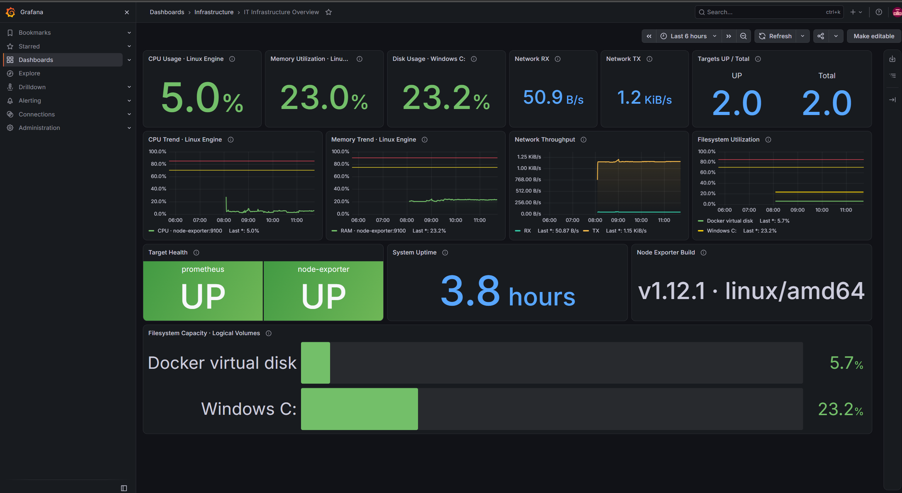
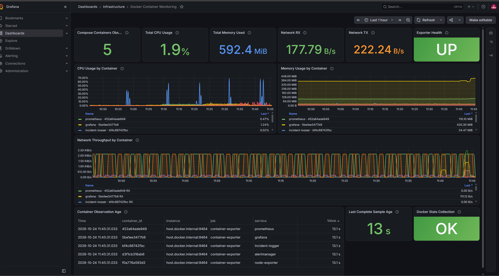
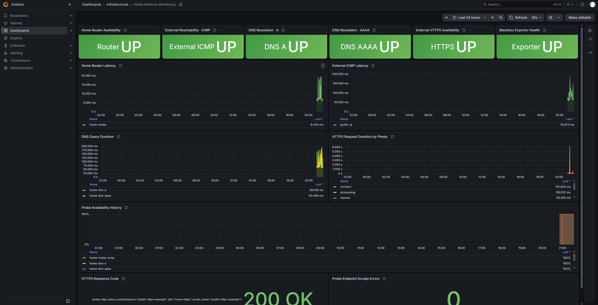

# IT Infrastructure Monitoring Center

> **ES — [Sitio web público](https://it-infrastructure-monitoring-center.pages.dev/):** capturas reales y documentación del proyecto; no muestra métricas en vivo.
>
> **EN — [Live Website](https://it-infrastructure-monitoring-center.pages.dev/):** authentic screenshots and project documentation; it does not display live metrics.

**ES —** Laboratorio local de observabilidad para una infraestructura Docker: métricas de host con Prometheus y Node Exporter, visualización en Grafana, reglas de alertas y registro de incidentes. Incluye un exporter Python opcional, ejecutado en Windows, para observar estadísticas de los contenedores del proyecto.

**EN —** A reproducible local observability lab for a Docker-based infrastructure: host metrics with Prometheus and Node Exporter, Grafana dashboards, alert rules, and an incident log. An optional Windows-hosted Python exporter collects statistics for this Compose project’s containers.

> Proyecto educativo y de portafolio. El laboratorio de monitoreo es local; el portal estático está publicado en Cloudflare Pages. La infraestructura no se presenta como una configuración de producción.

## Navegación

- [Funcionalidades](#funcionalidades)
- [Arquitectura y diagramas](#arquitectura-y-diagramas)
- [Dashboards](#dashboards)
- [Monitoreo y alertas](#monitoreo-y-alertas)
- [Evidencias](#evidencias)
- [GitHub Actions](#github-actions)
- [Requisitos e inicio rápido](#requisitos-e-inicio-rápido)
- [Pruebas](#pruebas)
- [Decisiones y límites de seguridad](#decisiones-y-límites-de-seguridad)
- [Documentación](#documentación)

## Funcionalidades

- Cinco servicios Compose existentes: Prometheus, Grafana, Node Exporter, Alertmanager e Incident Logger. Esta rama prepara un sexto servicio opcional, Blackbox Exporter, sin iniciarlo.
- Aprovisionamiento de datasource y dashboards Grafana desde archivos versionados.
- Métricas de CPU, memoria, filesystem, red, uptime y disponibilidad de targets.
- Reglas de alerta y registro persistente, rotado y local de eventos FIRING/RESOLVED.
- Exporter opcional Python para CPU, memoria y red por contenedor del proyecto Compose.
- Pruebas unitarias y validaciones estáticas/configuración en GitHub Actions.

## Stack

| Componente | Versión configurada | Propósito |
|---|---:|---|
| Prometheus | 3.15.0 | Scraping, TSDB y evaluación de reglas |
| Grafana | 13.2.4 | Dashboards provisionados |
| Node Exporter | 1.12.1 | Métricas del Linux visible al daemon |
| Alertmanager | 0.34.1 | Agrupación y entrega de alertas |
| Blackbox Exporter | 0.28.0 (digest fijado) | Sondas ICMP, DNS y HTTPS; integración doméstica aún no activada en el entorno local |
| Incident Logger | Python 3.13, biblioteca estándar | Webhook e historial local rotado |
| Container Exporter | Python 3.10+, biblioteca estándar | Snapshot opcional de estadísticas Docker |

## Arquitectura y diagramas

Los diagramas de [arquitectura](docs/architecture.md) y de [flujo de métricas, incidentes y CI](docs/diagrams.md) están escritos en Mermaid para renderizarse en GitHub.

El exporter de contenedores corre como proceso local de Windows, fuera de Docker. Prometheus lo consulta a través de host.docker.internal; no se monta el socket Docker en ningún contenedor.

## Dashboards

| Dashboard | Paneles | Fuente | Disponibilidad |
|---|---:|---|---|
| **IT Infrastructure Overview** | 14 | Prometheus / Node Exporter | Provisionado automáticamente |
| **Docker Container Monitoring** | 12 | Prometheus / exporter Python | Provisionado automáticamente; los datos recientes requieren iniciar el exporter manualmente |
| **Home Network Monitoring** | 13 | Prometheus / Blackbox Exporter | Provisionado automáticamente; la sonda del router requiere un archivo de targets local ignorado por Git |

El dashboard de infraestructura presenta KPIs, tendencias, salud de targets y capacidad de los volúmenes relevantes. Las métricas de CPU, memoria, red y uptime de Node Exporter describen el **Linux del motor Docker Desktop/WSL2**, no el Windows físico. Sus etiquetas distinguen el volumen compartido **Windows C:** (/mnt/host/c) del **Docker virtual disk** (/mnt/docker-desktop-disk).

Los dos dashboards se leen desde config/grafana/dashboards/ mediante el proveedor de archivos en config/grafana/provisioning/dashboards/dashboard-provider.yml. Grafana los vuelve a cargar periódicamente; no es necesario importarlos a mano.

### IT Infrastructure Overview

**ES:** Vista de capacidad, CPU, memoria, red, uptime y salud de targets. CPU, RAM, red y uptime representan el Linux del Docker Engine/WSL2; el disco C: y Docker virtual disk se identifican por separado.

**EN:** Host capacity, CPU, memory, network, uptime, and target health. CPU, RAM, network, and uptime describe the Docker Engine Linux environment; Windows C: and the Docker virtual disk are identified separately.

### Docker Container Monitoring

**ES:** Snapshot del exporter host-side con cinco contenedores observados, CPU, memoria, red y frescura de colección. Los IDs cortos visibles son metadatos efímeros del runtime, no credenciales.

**EN:** Host-side exporter snapshot with five observed containers, CPU, memory, network, and collection freshness. The visible short IDs are ephemeral runtime metadata, not credentials.

### Home Network Monitoring

**ES:** Evidencia auténtica de cinco sondas de red doméstica y Blackbox Exporter saludable. Es una captura estática: el portal no presenta métricas en vivo ni publica los targets privados.

**EN:** Authentic evidence of five home-network probes and a healthy Blackbox Exporter. This is a static screenshot; the site does not show live metrics or publish private targets.

Las capturas son evidencia auténtica de sus respectivos instantes. Las seis imágenes originales de la galería se mantienen idénticas; la captura de red doméstica se añadió como séptima evidencia sin alterar sus píxeles.

### Consultas representativas

~~~promql
# CPU ocupada del Linux Engine (%): promedio de CPU no idle
100 * (1 - avg by (instance) (rate(node_cpu_seconds_total{job="node-exporter",mode="idle"}[$__rate_interval])))

# Memoria utilizada (%)
100 * (1 - (node_memory_MemAvailable_bytes{job="node-exporter"} / node_memory_MemTotal_bytes{job="node-exporter"}))

# Disk usage de Windows C: (volumen /mnt/host/c)
100 * (1 - (node_filesystem_avail_bytes{job="node-exporter",mountpoint="/mnt/host/c"} / node_filesystem_size_bytes{job="node-exporter",mountpoint="/mnt/host/c"}))

# Network RX total; excluye loopback y dispositivos virtuales de contenedor
sum(rate(node_network_receive_bytes_total{job="node-exporter",device!~"lo|veth.*|docker.*|br-.*"}[$__rate_interval]))

# Network TX total; mismo filtro de interfaces
sum(rate(node_network_transmit_bytes_total{job="node-exporter",device!~"lo|veth.*|docker.*|br-.*"}[$__rate_interval]))

# Targets UP del alcance de infraestructura (KPI muestra UP/total)
sum(up{job=~"prometheus|node-exporter"})

# Total de targets en el alcance del KPI
count(up{job=~"prometheus|node-exporter"})

# Uptime en segundos; Grafana lo presenta como duración
time() - node_boot_time_seconds
~~~

El dashboard Docker consulta métricas itmc_container_*; sus agregados se limitan a series del job exporter y sus series por contenedor solo existen para el proyecto Compose seleccionado. Filesystem Capacity conserva /mnt/host/c y /mnt/docker-desktop-disk, agrupa con max by (mountpoint) para evitar duplicados lógicos y excluye device loop y fstype tmpfs, overlay, squashfs, proc, sysfs, cgroup, nsfs y devtmpfs. CPU/red excluyen loopback y las interfaces virtuales Docker. CPU, memoria y disco usan porcentaje; red usa bytes/s IEC y uptime se presenta como duración. Los umbrales principales son CPU 70/85 %, memoria 75/90 % y disco C: 75/90 %. Las unidades, filtros y semántica están descritos en [Arquitectura](docs/architecture.md) y [Exporter](docs/container-exporter.md).

### Home Network Monitoring — monitoreo local

Este dashboard independiente sondea el router local configurado en un archivo ignorado por Git y los destinos aprobados `1.1.1.1` y `example.com`. DNS consulta A/AAAA de `example.com` directamente al resolver aprobado; HTTPS usa el hostname y su resolución depende de Docker Desktop, sin seguir redirecciones a otros hosts. En la validación operativa de esta rama, las cinco sondas configuradas y el scrape de Blackbox devolvieron muestras recientes exitosas. El historial solo comienza con la configuración activa y no representa disponibilidad anterior. `up` describe el scrape del exporter/endpoint; `probe_success` describe el resultado de una sonda. Una alerta `BlackboxExporterDown` indica una interrupción de monitorización y no demuestra una caída del ISP. Consulta el [runbook](docs/runbooks/home-network.md) y el [postmortem redactado de preparación](docs/incidents/blackbox-exporter-preparation.md). Windows y Docker Desktop/WSL2 deben permanecer encendidos para mantener la observación continua.

Consulta [arquitectura y seguridad](docs/home-network-monitoring.md), [runbook](docs/runbooks/home-network.md), [notificaciones](docs/home-network-notifications.md) y [plantilla de postmortem](docs/templates/home-network-postmortem.md) antes de activarlo. Windows y Docker Desktop/WSL2 deben permanecer encendidos para mantener la observación continua.

## Monitoreo y alertas

El KPI **Targets UP / Total** de IT Infrastructure Overview cuenta solo los jobs Prometheus y Node Exporter, por eso indica **2/2**. La vista **Prometheus Targets** incluye además el job container-exporter y muestra **3/3**. Los dos valores tienen alcances distintos y son consistentes.

La captura de reglas muestra las cuatro reglas de infraestructura y TestIncident como **INACTIVE**. En esta evidencia, el laboratorio estaba en estado normal: las reglas están cargadas pero ninguna condición estaba activa; TestIncident permanece inactiva por diseño salvo durante una simulación controlada.

La captura de Alertmanager muestra **No alert groups found**. En ese momento no había grupos de alertas activos/recibidos para mostrar. Esto es coherente con el estado normal de las reglas y no indica por sí solo un fallo de Alertmanager.

## Evidencias

Las siguientes cuatro capturas complementan las dos vistas de Grafana. Los enlaces abren los PNG originales sin edición:

| Evidencia | Español | English |
|---|---|---|
| [Prometheus Targets](screenshots/03-prometheus-targets.png) | 3/3 targets UP; incluye Prometheus, Node Exporter y container-exporter. | 3/3 targets UP, including Prometheus, Node Exporter, and container-exporter. |
| [Reglas Prometheus](screenshots/04-prometheus-alert-rules.png) | Cuatro reglas de infraestructura y TestIncident inactivas en estado normal. | Four infrastructure rules and TestIncident inactive while the system is normal. |
| [Alertmanager](screenshots/05-alertmanager-no-active-groups.png) | Sin grupos activos en el instante de la captura. | No active groups at capture time. |
| [GitHub Actions CI](screenshots/06-github-actions-ci.png) | Ejecución #4 exitosa; los cuatro jobs aparecen en verde. | Successful run #4; all four jobs are green. |
| [Detalle de la ejecución CI #4](https://github.com/charrixxz23/it-infrastructure-monitoring-center/actions/runs/40109656359) | Registro remoto de GitHub Actions. | GitHub Actions run details. |

## GitHub Actions

En la [ejecución CI #4 del PR #1](https://github.com/charrixxz23/it-infrastructure-monitoring-center/actions/runs/40109656359) (commit de la rama del PR a07bbb4, posteriormente integrado en main como 56c5c87), GitHub Actions reportó éxito para los cuatro jobs:

1. Python 3.10 tests.
2. Python 3.13 tests.
3. Static quality and security checks.
4. Dashboard and monitoring configuration validation.

Ese resultado valida el código integrado en esa ejecución; **no es una ejecución de esta rama de documentación**. GitHub debe volver a ejecutar CI cuando se abra un PR con estos cambios. El badge muestra el estado actual del workflow remoto.

CI no inicia Docker Compose, no accede al daemon Windows/WSL2, no consulta métricas vivas ni autentica contra Grafana. Las comprobaciones estáticas y las pruebas con mocks están separadas de la validación local del runtime. Interpretación de fallos y comandos completos: [Integración continua](docs/ci.md).

## Requisitos e inicio rápido

- Windows 11, WSL2 y Docker Desktop con backend Linux para la configuración de referencia y las sondas domésticas.
- Docker Compose v2 o posterior; Python 3.10+ solo para el exporter host-side opcional.
- Puertos locales disponibles: 3000 (Grafana), 9090 (Prometheus), 9093 (Alertmanager) y, si se activa el exporter de contenedores, 9464. Blackbox escucha solo en su red Docker dedicada; no publica puerto al host.

Desde PowerShell en la raíz del repositorio:

~~~powershell
if (-not (Test-Path .env)) { Copy-Item .env.example .env }
if (-not (Test-Path config/prometheus/targets/home-network.yml)) {
  Copy-Item config/prometheus/targets/home-network.example.yml config/prometheus/targets/home-network.yml
}
notepad .env  # Define un valor local propio; no compartas el archivo.
notepad config/prometheus/targets/home-network.yml  # Una IP privada del router; el archivo está ignorado por Git.
docker compose version
docker compose config --quiet
# Solo después de revisar destinos y seguridad: inicia también Blackbox y sus sondas.
docker compose up -d
docker compose ps
~~~

En esta rama, `docker compose up -d` activa las sondas ICMP/DNS/HTTPS definidas. No ejecutes ese comando para activar esta función hasta revisar el [runbook](docs/runbooks/home-network.md); la integración no se ha iniciado en esta entrega.

Accesos locales: [Grafana](http://127.0.0.1:3000), [Prometheus](http://127.0.0.1:9090) y [Alertmanager](http://127.0.0.1:9093). Usa las credenciales que configures localmente en .env; el repositorio no publica credenciales.

Para el dashboard Docker opcional, espera a que Docker Desktop esté listo, confirma el contexto desktop-linux, y ejecuta en otra ventana PowerShell:

~~~powershell
docker context show
docker info
.\scripts\run-container-exporter.ps1
~~~

El proceso permanece en primer plano y escucha en 127.0.0.1:9464. Usa Ctrl+C para detenerlo y vuelve a ejecutar el script para iniciarlo. **No se instala un servicio ni una tarea automática**; tras reiniciar Windows se requiere inicio manual. Docker CLI hereda el acceso significativo del usuario al daemon: el filtro por etiqueta Compose limita la selección de estadísticas, pero no reduce esos privilegios. host.docker.internal resuelve la conectividad desde Prometheus a través del proxy de Docker Desktop; no autentica al contenedor cliente ni crea una ACL. Consulta [Seguridad y operación del exporter](docs/container-exporter.md).

## Pruebas

Desde PowerShell, con herramientas CI instaladas según [docs/ci.md](docs/ci.md):

~~~powershell
python -m compileall -q services scripts
python -m unittest discover -s services/incident-logger -p 'test_*.py' -v
python -m unittest discover -s services/container-exporter -p 'test_*.py' -v
python scripts/ci/validate_dashboards.py
python scripts/ci/check_repo_hygiene.py
python scripts/ci/validate_compose.py
.\scripts\validate.ps1
~~~

Con Docker Desktop activo, scripts/validate.ps1 comprueba el entorno local, las APIs de Prometheus/Grafana y el dashboard de infraestructura. Con el exporter iniciado, añade scripts/validate-container-exporter.ps1. Los unit tests del exporter simulan Docker CLI; no deben confundirse con la validación real del daemon local.

## Decisiones y límites de seguridad

- **Se descartó cAdvisor con sockets Docker/containerd.** Para obtener atribución de contenedores en el entorno evaluado requería acceso a interfaces sensibles del motor y metadatos del host. El acceso :ro al socket no convierte las operaciones de la API en solo lectura.
- **Se eligió un exporter host-side en Python.** Usa Docker CLI desde Windows, filtra por etiqueta Compose y consulta snapshots de estadísticas. Ningún contenedor recibe el socket.
- **El exporter sigue teniendo privilegios importantes.** El proceso hereda el acceso Docker del usuario; una modificación o vulnerabilidad podría abusar del daemon. Ejecuta solo código confiable y detén el proceso cuando no lo uses.
- **Loopback y host.docker.internal tienen alcances distintos.** El proceso escucha solo en 127.0.0.1; Docker Desktop proxifica el camino desde la red de contenedores. Esa ruta no autentica al cliente y otros contenedores locales podrían leer el endpoint acotado.
- **No es monitoreo del Windows físico.** Node Exporter mide el Linux visible al daemon. Para CPU/RAM del host Windows haría falta instrumentación específica de Windows, fuera del alcance actual.
- Laboratorio local sin TLS ni autenticación de producción para Prometheus/Alertmanager. Mantén sus interfaces ligadas a loopback.

## Documentación

- [Arquitectura, métricas y límites del host](docs/architecture.md)
- [Diagramas Mermaid](docs/diagrams.md)
- [Exporter Docker local](docs/container-exporter.md)
- [Home Network Monitoring: arquitectura, seguridad y activación](docs/home-network-monitoring.md)
- [Runbook de red doméstica](docs/runbooks/home-network.md)
- [Plan de notificaciones (Telegram evaluado, no configurado)](docs/home-network-notifications.md)
- [Plantilla de postmortem doméstico](docs/templates/home-network-postmortem.md)
- [Informe redactado del incidente de preparación de Blackbox](docs/incidents/blackbox-exporter-preparation.md)
- [Evaluación de seguridad de cAdvisor](docs/container-monitoring-assessment.md)
- [Integración continua](docs/ci.md)
- [Troubleshooting](docs/troubleshooting.md)
- [Resultados de validación resumidos](docs/verification-results.md)

## Fase 5 — Preparación cloud (Planned / In Development)

**ES:** La rama `feature/free-cloud-deployment` prepara localmente un portal estático para Cloudflare Pages y documenta una posible migración ARM64 a OCI Always Free. No se han creado cuentas ni recursos cloud, configurado DNS o desplegado servicios. El laboratorio existente no cambia.

**EN:** The `feature/free-cloud-deployment` branch locally prepares a static Cloudflare Pages portfolio and documents a possible ARM64 migration to OCI Always Free. No cloud accounts or resources have been created, no DNS has been configured, and no services have been deployed. The existing lab remains unchanged.

- [Portal estático](website/)
- [Arquitectura y diagramas cloud](docs/cloud/architecture.md) · [diagramas Mermaid](docs/cloud/diagrams.md)
- [Plan Oracle ARM64](docs/cloud/oracle-arm64-deployment-plan.md) · [estimación de cuotas y costos](docs/cloud/cost-assessment.md)
- [Plan Cloudflare Pages](docs/cloud/cloudflare-pages-plan.md)
- [Modelo de seguridad](docs/cloud/security-model.md) · [validación y criterios](docs/cloud/testing-plan.md)
