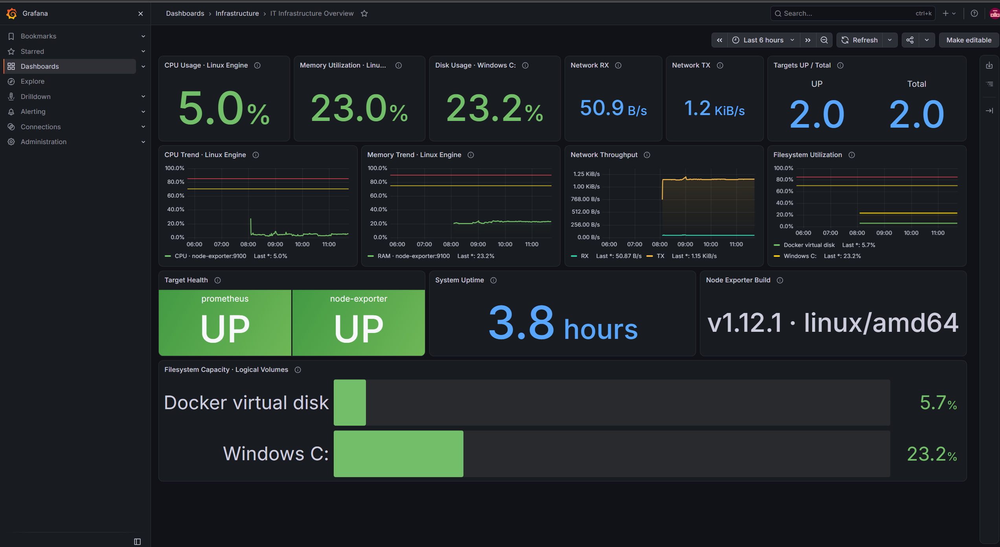
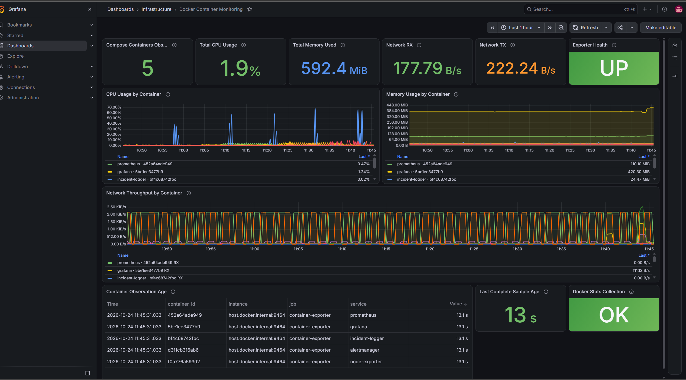
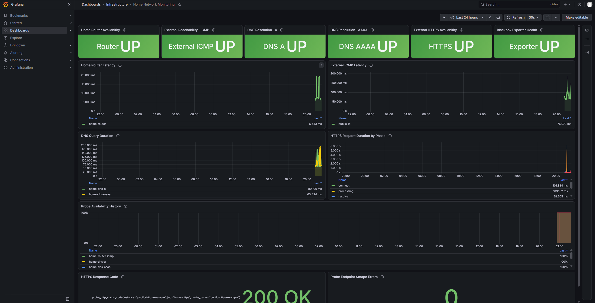
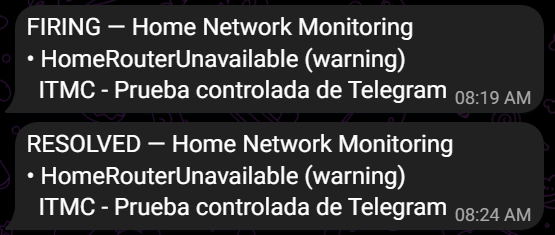

# IT Infrastructure Monitoring Center

> **ES — [Sitio web público](https://it-infrastructure-monitoring-center.pages.dev/):** capturas reales y documentación del proyecto; no muestra métricas en vivo.
>
> **EN — [Live Website](https://it-infrastructure-monitoring-center.pages.dev/):** authentic screenshots and project documentation; it does not display live metrics.

**ES —** Laboratorio local de observabilidad para una infraestructura Docker: métricas de host con Prometheus y Node Exporter, visualización en Grafana, reglas de alertas y registro de incidentes. Incluye un exporter Python opcional, ejecutado en Windows, para observar estadísticas de los contenedores del proyecto.

**EN —** A reproducible local observability lab for a Docker-based infrastructure: host metrics with Prometheus and Node Exporter, Grafana dashboards, alert rules, and an incident log. An optional Windows-hosted Python exporter collects statistics for this Compose project’s containers.

> Proyecto educativo y de portafolio. El laboratorio de monitoreo es local; el portal estático está publicado en Cloudflare Pages. La infraestructura no se presenta como una configuración de producción.

## Navegación

- [Funcionalidades](#funcionalidades)
- [Arquitectura y diagramas](#arquitectura-y-diagramas)
- [Dashboards](#dashboards)
- [Monitoreo y alertas](#monitoreo-y-alertas)
- [Evidencias](#evidencias)
- [GitHub Actions](#github-actions)
- [Requisitos e inicio rápido](#requisitos-e-inicio-rápido)
- [Pruebas](#pruebas)
- [Decisiones y límites de seguridad](#decisiones-y-límites-de-seguridad)
- [Documentación](#documentación)

## Funcionalidades

- Observabilidad local con Prometheus, Grafana, Node Exporter, Alertmanager, Incident Logger y Blackbox Exporter para las sondas domésticas.
- Aprovisionamiento de datasource y dashboards Grafana desde archivos versionados.
- Métricas de CPU, memoria, filesystem, red, uptime y disponibilidad de targets.
- Reglas de alerta y registro persistente, rotado y local de eventos FIRING/RESOLVED.
- Exporter opcional Python para CPU, memoria y red por contenedor del proyecto Compose.
- Agente opcional de external heartbeat: solo envía éxito si Prometheus, Alertmanager, Grafana e Incident Logger responden; requiere opt-in local y una política de egreso revisada.
- Pruebas unitarias y validaciones estáticas/configuración en GitHub Actions.

## Stack

| Componente | Versión configurada | Propósito |
|---|---:|---|
| Prometheus | 3.15.0 | Scraping, TSDB y evaluación de reglas |
| Grafana | 13.2.4 | Dashboards provisionados |
| Node Exporter | 1.12.1 | Métricas del Linux visible al daemon |
| Alertmanager | 0.34.1 | Agrupación y entrega de alertas |
| Blackbox Exporter | 0.28.0 (digest fijado) | Sondas ICMP, DNS y HTTPS para monitoreo local de red |
| Incident Logger | Python 3.13, biblioteca estándar | Webhook e historial local rotado |
| Container Exporter | Python 3.10+, biblioteca estándar | Snapshot opcional de estadísticas Docker |
| External Heartbeat | Python 3.13, biblioteca estándar | Dead-man's switch opt-in; operación real validada localmente con secreto ignorado por Git |

## Arquitectura y diagramas

Los diagramas de [arquitectura](docs/architecture.md) y de [flujo de métricas, incidentes y CI](docs/diagrams.md) están escritos en Mermaid para renderizarse en GitHub.

El exporter de contenedores corre como proceso local de Windows, fuera de Docker. Prometheus lo consulta a través de host.docker.internal; no se monta el socket Docker en ningún contenedor.

## Dashboards

| Dashboard | Paneles | Fuente | Disponibilidad |
|---|---:|---|---|
| **IT Infrastructure Overview** | 14 | Prometheus / Node Exporter | Provisionado automáticamente |
| **Docker Container Monitoring** | 12 | Prometheus / exporter Python | Provisionado automáticamente; los datos recientes requieren iniciar el exporter manualmente |
| **Home Network Monitoring** | 13 | Prometheus / Blackbox Exporter | Provisionado automáticamente; la sonda del router requiere un archivo de targets local ignorado por Git |

El dashboard de infraestructura presenta KPIs, tendencias, salud de targets y capacidad de los volúmenes relevantes. Las métricas de CPU, memoria, red y uptime de Node Exporter describen el **Linux del motor Docker Desktop/WSL2**, no el Windows físico. Sus etiquetas distinguen el volumen compartido **Windows C:** (/mnt/host/c) del **Docker virtual disk** (/mnt/docker-desktop-disk).

La integración opcional de external heartbeat sigue siendo opt-in y no forma parte del Compose predeterminado. Comprueba cuatro endpoints HTTP del plano de monitoreo; no representa la disponibilidad de destinos de red, Node Exporter ni cada target. El propietario corrigió la cronología: la validación inicial aún usaba la credencial original; después reemplazó el secreto local y confirmó la eliminación del check anterior. La evidencia del check nuevo se resume abajo y en el [diseño y runbook](docs/external-heartbeat.md). El secreto vigente permanece fuera de Git. La política de egreso depende del supervisor y del host Docker/Windows; no es una allowlist aplicada por el firewall global de Windows.

Los dos dashboards se leen desde config/grafana/dashboards/ mediante el proveedor de archivos en config/grafana/provisioning/dashboards/dashboard-provider.yml. Grafana los vuelve a cargar periódicamente; no es necesario importarlos a mano.

### IT Infrastructure Overview

**ES:** Vista de capacidad, CPU, memoria, red, uptime y salud de targets. CPU, RAM, red y uptime representan el Linux del Docker Engine/WSL2; el disco C: y Docker virtual disk se identifican por separado.

**EN:** Host capacity, CPU, memory, network, uptime, and target health. CPU, RAM, network, and uptime describe the Docker Engine Linux environment; Windows C: and the Docker virtual disk are identified separately.

### Docker Container Monitoring

**ES:** Snapshot del exporter host-side con cinco contenedores observados, CPU, memoria, red y frescura de colección. Los IDs cortos visibles son metadatos efímeros del runtime, no credenciales.

**EN:** Host-side exporter snapshot with five observed containers, CPU, memory, network, and collection freshness. The visible short IDs are ephemeral runtime metadata, not credentials.

### Home Network Monitoring

**ES:** Evidencia auténtica de cinco sondas de red doméstica y Blackbox Exporter saludable. Es una captura estática: el portal no presenta métricas en vivo ni publica los targets privados.

**EN:** Authentic evidence of five home-network probes and a healthy Blackbox Exporter. This is a static screenshot; the site does not show live metrics or publish private targets.

Las capturas son evidencia auténtica de sus respectivos instantes. Las seis imágenes originales de Grafana/Prometheus/GitHub Actions y la captura 07 de Home Network Monitoring se conservan sin alteración. La captura 08 de Telegram es un recorte exacto de la imagen original: presenta solo la prueba sintética warning FIRING → RESOLVED; no se retocaron sus píxeles ni los valores.

### Consultas representativas

~~~promql
# CPU ocupada del Linux Engine (%): promedio de CPU no idle
100 * (1 - avg by (instance) (rate(node_cpu_seconds_total{job="node-exporter",mode="idle"}[$__rate_interval])))

# Memoria utilizada (%)
100 * (1 - (node_memory_MemAvailable_bytes{job="node-exporter"} / node_memory_MemTotal_bytes{job="node-exporter"}))

# Disk usage de Windows C: (volumen /mnt/host/c)
100 * (1 - (node_filesystem_avail_bytes{job="node-exporter",mountpoint="/mnt/host/c"} / node_filesystem_size_bytes{job="node-exporter",mountpoint="/mnt/host/c"}))

# Network RX total; excluye loopback y dispositivos virtuales de contenedor
sum(rate(node_network_receive_bytes_total{job="node-exporter",device!~"lo|veth.*|docker.*|br-.*"}[$__rate_interval]))

# Network TX total; mismo filtro de interfaces
sum(rate(node_network_transmit_bytes_total{job="node-exporter",device!~"lo|veth.*|docker.*|br-.*"}[$__rate_interval]))

# Targets UP del alcance de infraestructura (KPI muestra UP/total)
sum(up{job=~"prometheus|node-exporter"})

# Total de targets en el alcance del KPI
count(up{job=~"prometheus|node-exporter"})

# Uptime en segundos; Grafana lo presenta como duración
time() - node_boot_time_seconds
~~~

El dashboard Docker consulta métricas itmc_container_*; sus agregados se limitan a series del job exporter y sus series por contenedor solo existen para el proyecto Compose seleccionado. Filesystem Capacity conserva /mnt/host/c y /mnt/docker-desktop-disk, agrupa con max by (mountpoint) para evitar duplicados lógicos y excluye device loop y fstype tmpfs, overlay, squashfs, proc, sysfs, cgroup, nsfs y devtmpfs. CPU/red excluyen loopback y las interfaces virtuales Docker. CPU, memoria y disco usan porcentaje; red usa bytes/s IEC y uptime se presenta como duración. Los umbrales principales son CPU 70/85 %, memoria 75/90 % y disco C: 75/90 %. Las unidades, filtros y semántica están descritos en [Arquitectura](docs/architecture.md) y [Exporter](docs/container-exporter.md).

### Home Network Monitoring — monitoreo local

Este dashboard independiente sondea el router local configurado en un archivo ignorado por Git y los destinos aprobados `1.1.1.1` y `example.com`. DNS consulta A/AAAA de `example.com` directamente al resolver aprobado; HTTPS usa el hostname y su resolución depende de Docker Desktop, sin seguir redirecciones a otros hosts. En la validación operativa de esta rama, las cinco sondas configuradas y el scrape de Blackbox devolvieron muestras recientes exitosas. El historial solo comienza con la configuración activa y no representa disponibilidad anterior. `up` describe el scrape del exporter/endpoint; `probe_success` describe el resultado de una sonda. Una alerta `BlackboxExporterDown` indica una interrupción de monitorización y no demuestra una caída del ISP. Consulta el [runbook](docs/runbooks/home-network.md) y el [postmortem redactado de preparación](docs/incidents/blackbox-exporter-preparation.md). Windows y Docker Desktop/WSL2 deben permanecer encendidos para mantener la observación continua.

Consulta [arquitectura y seguridad](docs/home-network-monitoring.md), [runbook](docs/runbooks/home-network.md), [notificaciones](docs/home-network-notifications.md) y [plantilla de postmortem](docs/templates/home-network-postmortem.md) para operar el monitoreo local. Windows y Docker Desktop/WSL2 deben permanecer encendidos para mantener la observación continua.

### External heartbeat — operación opt-in validada

**ES:** El agente sigue siendo opt-in y no se incluye en el Compose predeterminado. Comprueba Prometheus, Alertmanager, Grafana e Incident Logger y solo informa éxito tras cuatro respuestas saludables. El namespace de Squid combina su ACL con un filtro IPv4/IPv6 independiente y direcciones IPv4 dinámicas para el host autorizado en TCP/443. En la cronología corregida por el propietario, la validación inicial todavía usaba la credencial original: sus tres ciclos aceptados fueron a las 16:06:10, 16:07:09 y 16:08:09 UTC del 5 de noviembre de 2026. Después, el propietario creó un check nuevo, sustituyó el secreto local ignorado por Git y recreó únicamente `heartbeat-agent`. Informó que el agente llegó a `healthy` y que cuatro ciclos posteriores fueron aceptados a las 17:29:10, 17:30:10, 17:31:10 y 17:32:10 UTC; el check nuevo aparecía verde y recibiendo pings automáticos. El check original dejó de recibir pings, apareció `Down` y el propietario confirmó posteriormente que lo eliminó; no se proporcionó la hora de eliminación. Estos datos del proveedor y la cronología posterior son confirmaciones del propietario, no una consulta independiente ni métricas en vivo. El valor vigente permanece fuera de Git. La operación se limita a esos cuatro endpoints y no consulta las sondas domésticas ni envía métricas. El aislamiento no protege frente a un supervisor de política, Docker host o Windows comprometidos.

**EN:** The agent remains opt-in and is not part of the default Compose stack. It checks Prometheus, Alertmanager, Grafana, and Incident Logger, and reports success only after all four health checks pass. Squid ACLs are backed by an independent IPv4/IPv6 filter in its shared network namespace, with dynamic IPv4 destinations for the approved host on TCP/443. In the owner's corrected timeline, the initial validation still used the original credential; its three accepted cycles were recorded at 16:06:10, 16:07:09, and 16:08:09 UTC on November 5, 2026. Later, the owner created a new check, replaced the Git-ignored local secret, and recreated only `heartbeat-agent`. The owner reported that the agent reached `healthy` and four subsequent cycles were accepted at 17:29:10, 17:30:10, 17:31:10, and 17:32:10 UTC; the new check appeared green and receiving automatic pings. The original check stopped receiving pings, appeared `Down`, and the owner later confirmed deleting it; no deletion time was provided. Provider state and the later timeline are owner-confirmed, not independently queried or live metrics. The current secret remains outside Git. This monitors only those four endpoints and does not inspect home probes or send metrics. The isolation does not protect against a compromised policy supervisor, Docker host, or Windows host.

See the [external heartbeat design, evidence, and residual risks](docs/external-heartbeat.md) and the [operational, troubleshooting, and rotation runbook](docs/runbooks/external-heartbeat.md). Option B uses internal agent networks, a separate proxy-namespace firewall, and Squid's exact-host/port policy. No host firewall rule was changed. The owner-reported real cycles and provider notifications are summarized in the design document; their exact Down/Up transition timing and cause were not recorded.

### Backup & Disaster Recovery — Fase 10.1

**ES:** La preparación de respaldos es local y manual. `scripts/backup-itmc.ps1` usa `Plan` por defecto; `scripts/inventory-itmc.ps1` consulta solo metadatos Docker de los cuatro volúmenes y servicios esperados. El modo explícito `BackupConfig` empaqueta únicamente archivos versionados en `HEAD`, excluye secretos, targets locales, datos y bases activas, e incluye un manifiesto con commit y hashes SHA-256. No es un respaldo integral ni de volúmenes. Las copias coherentes de Prometheus, Grafana/SQLite, Alertmanager e Incident Logger siguen pendientes hasta validar una estrategia y restauración aislada. No guardes artefactos en GitHub, CI o Cloudflare. Consulta la [guía de alcance](docs/backup-recovery.md) y el [runbook de recuperación](docs/runbooks/disaster-recovery.md).

**EN:** Backup preparation is local and manual. `scripts/backup-itmc.ps1` defaults to `Plan`; `scripts/inventory-itmc.ps1` reads only Docker metadata for the four expected volumes and project services. Explicit `BackupConfig` packages only files committed at `HEAD`, excludes secrets, local targets, runtime data, and active databases, and embeds a manifest with commit and SHA-256 hashes. It is neither a full-system nor volume backup. Consistent backups of Prometheus, Grafana/SQLite, Alertmanager, and Incident Logger remain pending until a strategy and isolated restore are validated. Do not store artifacts in GitHub, CI, or Cloudflare. See the [scope guide](docs/backup-recovery.md) and [disaster recovery runbook](docs/runbooks/disaster-recovery.md).

## Monitoreo y alertas

El KPI **Targets UP / Total** de IT Infrastructure Overview cuenta solo los jobs Prometheus y Node Exporter, por eso indica **2/2**. La vista **Prometheus Targets** incluye además el job container-exporter y muestra **3/3**. Los dos valores tienen alcances distintos y son consistentes.

La captura de reglas muestra las cuatro reglas de infraestructura y TestIncident como **INACTIVE**. En esta evidencia, el laboratorio estaba en estado normal: las reglas están cargadas pero ninguna condición estaba activa; TestIncident permanece inactiva por diseño salvo durante una simulación controlada.

La captura de Alertmanager muestra **No alert groups found**. En ese momento no había grupos de alertas activos/recibidos para mostrar. Esto es coherente con el estado normal de las reglas y no indica por sí solo un fallo de Alertmanager.

### Telegram — prueba de ciclo FIRING → RESOLVED

**ES:** Se verificó localmente una alerta doméstica sintética `HomeRouterUnavailable` de severidad `warning`: Alertmanager entregó FIRING y RESOLVED al bot privado y el Incident Logger conservó ambos eventos. La captura es evidencia recortada de esa prueba controlada; no representa una caída real del router ni del ISP. La notificación Telegram es opt-in en instalaciones nuevas y esta prueba no demuestra servicio continuo.

**EN:** A synthetic `HomeRouterUnavailable` warning was validated locally: Alertmanager delivered FIRING and RESOLVED to a private bot, and the Incident Logger retained both events. The cropped screenshot is evidence of that controlled test; it does not represent a real router or ISP outage. Telegram remains opt-in for new installations, and this test does not establish continuous service.

Consulta el [informe de validación de Fase 8](docs/phase-8-telegram-validation.md) para la evidencia, los tiempos observados, las limitaciones y el tratamiento de una pareja posterior de alertas críticas no correlacionadas.

## Evidencias

Estas capturas complementan las dos vistas de Grafana:

| Evidencia | Español | English |
|---|---|---|
| [Prometheus Targets](screenshots/03-prometheus-targets.png) | 3/3 targets UP; incluye Prometheus, Node Exporter y container-exporter. | 3/3 targets UP, including Prometheus, Node Exporter, and container-exporter. |
| [Reglas Prometheus](screenshots/04-prometheus-alert-rules.png) | Cuatro reglas de infraestructura y TestIncident inactivas en estado normal. | Four infrastructure rules and TestIncident inactive while the system is normal. |
| [Alertmanager](screenshots/05-alertmanager-no-active-groups.png) | Sin grupos activos en el instante de la captura. | No active groups at capture time. |
| [GitHub Actions CI](screenshots/06-github-actions-ci.png) | Ejecución #4 exitosa; los cuatro jobs aparecen en verde. | Successful run #4; all four jobs are green. |
| [Telegram FIRING → RESOLVED](screenshots/08-telegram-alerting.png) | Recorte auténtico de la prueba sintética warning; no es una caída de red real. | Authentic crop of the synthetic warning test; not a real network outage. |
| [Detalle de la ejecución CI #4](https://github.com/charrixxz23/it-infrastructure-monitoring-center/actions/runs/40109656359) | Registro remoto de GitHub Actions. | GitHub Actions run details. |

## GitHub Actions

En la [ejecución CI #4 del PR #1](https://github.com/charrixxz23/it-infrastructure-monitoring-center/actions/runs/40109656359) (commit de la rama del PR a07bbb4, posteriormente integrado en main como 56c5c87), GitHub Actions reportó éxito para los cuatro jobs:

1. Python 3.10 tests.
2. Python 3.13 tests.
3. Static quality and security checks.
4. Dashboard and monitoring configuration validation.

Ese resultado valida el código integrado en esa ejecución; **no es una ejecución de esta rama de documentación**. GitHub debe volver a ejecutar CI cuando se abra un PR con estos cambios. El badge muestra el estado actual del workflow remoto.

CI no inicia Docker Compose, no accede al daemon Windows/WSL2, no consulta métricas vivas ni autentica contra Grafana. Las comprobaciones estáticas y las pruebas con mocks están separadas de la validación local del runtime. Interpretación de fallos y comandos completos: [Integración continua](docs/ci.md).

## Requisitos e inicio rápido

- Windows 11, WSL2 y Docker Desktop con backend Linux para la configuración de referencia y las sondas domésticas.
- Docker Compose v2 o posterior; Python 3.10+ solo para el exporter host-side opcional.
- Puertos locales disponibles: 3000 (Grafana), 9090 (Prometheus), 9093 (Alertmanager) y, si se activa el exporter de contenedores, 9464. Blackbox escucha solo en su red Docker dedicada; no publica puerto al host.

Desde PowerShell en la raíz del repositorio:

~~~powershell
if (-not (Test-Path .env)) { Copy-Item .env.example .env }
if (-not (Test-Path config/prometheus/targets/home-network.yml)) {
  Copy-Item config/prometheus/targets/home-network.example.yml config/prometheus/targets/home-network.yml
}
notepad .env  # Define un valor local propio; no compartas el archivo.
notepad config/prometheus/targets/home-network.yml  # Una IP privada del router; el archivo está ignorado por Git.
docker compose version
docker compose config --quiet
# Solo después de revisar destinos y seguridad: inicia también Blackbox y sus sondas.
docker compose up -d
docker compose ps
~~~

En una instalación limpia, configura primero el archivo de targets local ignorado por Git y revisa el [runbook](docs/runbooks/home-network.md) antes de iniciar las sondas con Compose. La validación doméstica descrita aquí se realizó localmente; el portal no está conectado a esos servicios.

Accesos locales: [Grafana](http://127.0.0.1:3000), [Prometheus](http://127.0.0.1:9090) y [Alertmanager](http://127.0.0.1:9093). Usa las credenciales que configures localmente en .env; el repositorio no publica credenciales.

Para el dashboard Docker opcional, espera a que Docker Desktop esté listo, confirma el contexto desktop-linux, y ejecuta en otra ventana PowerShell:

~~~powershell
docker context show
docker info
.\scripts\run-container-exporter.ps1
~~~

El proceso permanece en primer plano y escucha en 127.0.0.1:9464. Usa Ctrl+C para detenerlo y vuelve a ejecutar el script para iniciarlo. **No se instala un servicio ni una tarea automática**; tras reiniciar Windows se requiere inicio manual. Docker CLI hereda el acceso significativo del usuario al daemon: el filtro por etiqueta Compose limita la selección de estadísticas, pero no reduce esos privilegios. host.docker.internal resuelve la conectividad desde Prometheus a través del proxy de Docker Desktop; no autentica al contenedor cliente ni crea una ACL. Consulta [Seguridad y operación del exporter](docs/container-exporter.md).

## Pruebas

Desde PowerShell, con herramientas CI instaladas según [docs/ci.md](docs/ci.md):

~~~powershell
python -m compileall -q services scripts
python -m unittest discover -s services/incident-logger -p 'test_*.py' -v
python -m unittest discover -s services/container-exporter -p 'test_*.py' -v
python -m unittest discover -s services/heartbeat-agent -p 'test_*.py' -v
python scripts/ci/validate_dashboards.py
python scripts/ci/validate_heartbeat.py
python scripts/ci/check_repo_hygiene.py
python scripts/ci/validate_compose.py
.\scripts\validate.ps1
~~~

Con Docker Desktop activo, scripts/validate.ps1 comprueba el entorno local, las APIs de Prometheus/Grafana y el dashboard de infraestructura. Con el exporter iniciado, añade scripts/validate-container-exporter.ps1. Los unit tests del exporter simulan Docker CLI; no deben confundirse con la validación real del daemon local.

## Decisiones y límites de seguridad

- **Se descartó cAdvisor con sockets Docker/containerd.** Para obtener atribución de contenedores en el entorno evaluado requería acceso a interfaces sensibles del motor y metadatos del host. El acceso :ro al socket no convierte las operaciones de la API en solo lectura.
- **Se eligió un exporter host-side en Python.** Usa Docker CLI desde Windows, filtra por etiqueta Compose y consulta snapshots de estadísticas. Ningún contenedor recibe el socket.
- **El exporter sigue teniendo privilegios importantes.** El proceso hereda el acceso Docker del usuario; una modificación o vulnerabilidad podría abusar del daemon. Ejecuta solo código confiable y detén el proceso cuando no lo uses.
- **Loopback y host.docker.internal tienen alcances distintos.** El proceso escucha solo en 127.0.0.1; Docker Desktop proxifica el camino desde la red de contenedores. Esa ruta no autentica al cliente y otros contenedores locales podrían leer el endpoint acotado.
- **External heartbeat sigue siendo opt-in.** No publica puertos al host y su health endpoint enlaza a `127.0.0.1`. El agente depende del supervisor privilegiado y del host Docker/Windows; la red bridge no es una allowlist y no se aplicaron reglas al firewall global. El secreto bearer se monta como archivo de solo lectura y permanece fuera de Git.
- **Evidencia del proveedor.** El propietario confirmó la transición `Down → Up`, los pings y correos de caída/recuperación, y posteriormente la eliminación del check original tras reemplazar la credencial. No se registró la hora de eliminación ni el momento o causa exactos de la transición. Una caída completa de Windows, Docker Desktop o Internet puede impedir tanto los pings como las notificaciones oportunas.
- **No es monitoreo del Windows físico.** Node Exporter mide el Linux visible al daemon. Para CPU/RAM del host Windows haría falta instrumentación específica de Windows, fuera del alcance actual.
- Laboratorio local sin TLS ni autenticación de producción para Prometheus/Alertmanager. Mantén sus interfaces ligadas a loopback.

## Documentación

- [Arquitectura, métricas y límites del host](docs/architecture.md)
- [Diagramas Mermaid](docs/diagrams.md)
- [Exporter Docker local](docs/container-exporter.md)
- [Home Network Monitoring: arquitectura, seguridad y activación](docs/home-network-monitoring.md)
- [Runbook de red doméstica](docs/runbooks/home-network.md)
- [Operación de notificaciones Telegram](docs/home-network-notifications.md)
- [Validación local del ciclo Telegram de Fase 8](docs/phase-8-telegram-validation.md)
- [Diseño y seguridad del external heartbeat](docs/external-heartbeat.md)
- [Runbook de activación y rollback del external heartbeat](docs/runbooks/external-heartbeat.md)
- [Plantilla de postmortem doméstico](docs/templates/home-network-postmortem.md)
- [Informe redactado del incidente de preparación de Blackbox](docs/incidents/blackbox-exporter-preparation.md)
- [Evaluación de seguridad de cAdvisor](docs/container-monitoring-assessment.md)
- [Integración continua](docs/ci.md)
- [Troubleshooting](docs/troubleshooting.md)
- [Resultados de validación resumidos](docs/verification-results.md)

## Portal público y plan cloud

**ES:** El portal estático de documentación y capturas está publicado en Cloudflare Pages. No consulta los servicios locales ni presenta métricas en vivo. La documentación de Oracle Cloud Infrastructure describe una posible arquitectura; no se han desplegado allí servicios de monitoreo.

**EN:** The static documentation and screenshot portfolio is published on Cloudflare Pages. It does not query local services or display live metrics. Oracle Cloud Infrastructure documentation describes a possible architecture; no monitoring services have been deployed there.

- [Portal estático](website/)
- [Arquitectura y diagramas cloud](docs/cloud/architecture.md) · [diagramas Mermaid](docs/cloud/diagrams.md)
- [Plan Oracle ARM64](docs/cloud/oracle-arm64-deployment-plan.md) · [estimación de cuotas y costos](docs/cloud/cost-assessment.md)
- [Plan Cloudflare Pages](docs/cloud/cloudflare-pages-plan.md)
- [Modelo de seguridad](docs/cloud/security-model.md) · [validación y criterios](docs/cloud/testing-plan.md)
