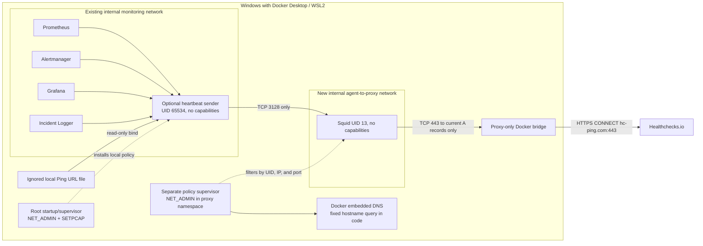

# External heartbeat — design and security

**Status:** option B includes the existing agent-namespace firewall and Squid ACL, plus a separate firewall on the network namespace Squid shares. The proxy filter dynamically allows only current public IPv4 answers for the exact `hc-ping.com` hostname on TCP/443; IPv6 and other egress are denied. Docker Desktop/WSL2 host egress remains outside this namespace boundary. A disposable runtime check on this Docker Desktop/WSL2 host verified the implemented proxy-namespace rules against a synthetic internal endpoint; no provider DNS lookup, CONNECT, TLS handshake, Ping URL, or real ping was performed. The owner reports that a Healthchecks.io project/check was created manually with a 2-minute period, 2-minute grace, and email notification. The Ping URL has not been stored locally or mounted into Docker; missed-ping/recovery behavior is untested. The integration remains opt-in and is not approved for real heartbeat activation pending an explicitly authorized provider TLS test and review of supervisor/host risks.

## Purpose and scope

The optional agent sends a success ping every 60 seconds only after all four required HTTP endpoints respond successfully:

| Component | Local check | What it establishes |
|---|---|---|
| Prometheus | `/-/ready` | The server is ready to serve requests |
| Alertmanager | `/-/ready` | The server is ready to serve requests |
| Grafana | `/api/health` | The Grafana HTTP health endpoint responds successfully |
| Incident Logger | `/health` | The local incident receiver responds successfully |

This checks the monitoring control path. It does not assert that every scrape target, alert rule, dashboard query, home-network probe, or monitored system is healthy. Blackbox Exporter and its probes, Node Exporter, and the Windows Container Exporter are outside this heartbeat. Prometheus readiness does not prove that targets are `UP` or that a specific rule is loaded.

If Windows, Docker Desktop, the agent, or the site's Internet connection is unavailable, the provider can observe missing pings after its configured schedule and grace period. Notification delivery still depends on the provider and its independent notification channel.

## Architecture

`compose.yaml` remains unchanged and does not include the heartbeat services. `compose.heartbeat.yaml` adds the opt-in agent, Squid, a network-policy supervisor, and their dedicated networks. The agent attaches to the existing internal monitoring network and an internal private network. The policy supervisor owns the namespace and the only attachment to the ordinary proxy uplink. Squid uses `network_mode: service:heartbeat-egress-policy`, sharing that namespace and gaining no second interface. The private proxy address remains assigned to the namespace owner. No service publishes a host port, uses host networking, mounts Docker Socket, or runs privileged. Docker's `internal: true` network property restricts external connectivity; it is not a destination allowlist and is not treated as the only security control.

The container entrypoint starts as root with only `NET_ADMIN`, `NET_BIND_SERVICE`, `SETPCAP`, `SETUID`, `SETGID`, and `KILL` added after `cap_drop: ALL`. The identity capabilities let it drop dnsmasq and the heartbeat child to separate non-root users. `KILL` lets the supervisor signal those processes for DNS reload and orderly shutdown. Before forking/execing the heartbeat sender it installs IPv4 and IPv6 output/input policy, prepares a local fixed-record DNS resolver, waits for the four internal endpoints and proxy, then installs the final rules. Each firewall chain ends in DROP. Updates build inactive chains completely and switch the active hook with one replacement command so a rule-installation failure does not flush the live policy. A failed initial setup exits before the sender is created.

The parent supervisor remains root with those capabilities so it can refresh the firewall and resolver when Compose recreates services. It does not load the Ping URL or send requests to the provider. The child that runs `heartbeat_agent.py` changes to UID/GID 65534, drops its capability bounding/effective/permitted/ambient sets, and verifies `NoNewPrivs`. Only that child reads the secret file and sends heartbeat requests. This split retains a privileged supervisor in the agent container and is a residual trust boundary; it is not equivalent to a wholly unprivileged container.

The agent's `/etc/resolv.conf` points to its local dnsmasq instance with no upstream and no host-file fallback. It serves only the four fixed Compose service names after the agent supervisor resolves those names through Docker's embedded resolver. Agent-UID queries to embedded DNS are blocked. Docker Desktop translates `127.0.0.11:53` to a dynamic high port before the OUTPUT filter, so that supervisor permits only root-owned UDP/TCP to the resolver address without a port match. Its code requests only four fixed service names; this is a code-level restriction and its root supervisor remains a trust boundary. Agent IPv4 output is limited to those private service IPs on fixed HTTP ports and the proxy address on TCP 3128; other IPv4 and non-loopback IPv6 output is dropped.

The proxy namespace has a second independent INPUT/OUTPUT policy. IPv4 and IPv6 default policies are DROP. The supervisor first installs an empty egress policy, resolves only the constant `hc-ping.com` via Docker's embedded DNS, rejects non-global IPv4 results and more than 16 addresses, then serves those records from local dnsmasq configured with `no-resolv` and `no-hosts`. Squid's read-only resolver file points to that local-only DNS service. Output permits loopback, root-owned DNS to `127.0.0.11` for the code-fixed resolver, replies from Squid's TCP/3128 listener to the fixed agent address, and UID 13 TCP/443 only to the currently resolved provider addresses. All other IPv4 output and non-loopback IPv6 output are dropped. Input accepts only the fixed agent source on TCP/3128, loopback, and established replies. Squid cannot write these rules because it has UID 13, no capabilities, and `no-new-privileges`.

When provider DNS answers change, the policy removes all provider egress first, atomically updates local DNS records, verifies the new set, and then enables TCP/443 to those addresses. This short transition may interrupt one heartbeat but avoids temporarily allowing both old and new CDN addresses. The resolver follows CNAME chains and schedules refresh at half the shortest TTL, capped at 15 seconds. A DNS refresh failure attempts an empty allowlist and clears local records. If a firewall update itself fails, the supervisor tries to flush only its own active OUTPUT chains while keeping the namespace default DROP; it marks the policy unhealthy and retries. If even that emergency deny command fails, the previous narrow chain may remain active until the filter recovers. At startup, firewall, DNS, or capability failures prevent the policy from becoming healthy, so Compose will not start Squid and the agent dependency chain will not start.

Squid listens only on the private network address and is configured with no published port, no Linux capabilities, a read-only root filesystem, and non-root UID 13. It accepts only the fixed agent source address, HTTPS `CONNECT`, port 443, and the exact `hc-ping.com` hostname; private, loopback, link-local, shared, documentation, multicast, and reserved destination ranges are denied, followed by `deny all`. `dstdomain -n` avoids reverse DNS for IP-literal requests. Python uses an explicit mandatory proxy handler that ignores `no_proxy`; internal health checks use a separate direct transport. Proxy errors have no direct fallback.

Squid does not decrypt TLS. It sees the CONNECT authority and port, not the encrypted Ping URL path. The proxy therefore cannot redact or inspect that path; access and cache logs are disabled. Squid's UID is limited by the independent namespace firewall, though a compromised Squid process can send arbitrary TLS payloads to the currently permitted provider IPs on TCP/443. The policy supervisor is a separate trust boundary: a compromise of that root process can rewrite its firewall or query arbitrary DNS through Docker's embedded resolver. No host-level outbound rules are installed, and this design does not constrain unrelated Docker Desktop traffic.

## Egress assessment and remaining host limits

The prior read-only host audit found the `desktop-linux` Docker context, the existing `itmc-monitoring` bridge marked internal, no outbound-deny policy in the inspected Windows Firewall/WSL Hyper-V configuration, and Docker Engine proxy settings whose values were not read. Those settings do not prove that runtime container traffic is forced through an enforcing proxy. No host firewall, Docker Desktop, WSL, or existing project service configuration is changed by this PR.

Docker documents that custom bridge networks use the embedded DNS service and that an `internal` network has no normal external route; an attached host or another network can still change the effective path. Review [Docker network creation](https://docs.docker.com/reference/cli/docker/network/create/) and [Compose network options](https://docs.docker.com/reference/compose-file/networks/). Docker Desktop routes container traffic through its VM/backend path on Windows ([Docker Desktop networking](https://docs.docker.com/desktop/features/networking/)); Windows Firewall or WSL Hyper-V rules for that shared backend could affect unrelated containers. The host audit did not establish the exact behavior of every VPN/EDR, DNS-tunneling, mirrored networking, or future Docker Desktop configuration.

The agent firewall is defense in depth inside its own network namespace. It does not protect against a Docker administrator who can replace the image, alter Compose, attach another interface, or execute as container root. The fixed private subnet must be checked for overlap before activation; a collision should prevent network creation and must be resolved by changing the documented fixed addresses consistently, then rerunning all checks. Do not add host firewall rules as a workaround.

## Squid policy and DNS limits

The exact-host ACL matches `hc-ping.com`; it does not allow a suffix or arbitrary destination. The `CONNECT` and port checks reject ordinary HTTP methods and any port other than 443. IP-literal destinations fail the hostname check. A DNS result in the blocked address ranges is rejected by the destination ACL. Squid's official [ACL reference](https://www.squid-cache.org/Doc/config/acl/) documents `dst`, `dstdomain -n`, and their lookup behavior; its [access-control guide](https://www.squid-cache.org/Doc/config/http_access/) documents the ordered deny/allow rules. Runtime tests in this PR must use reserved test destinations and a private-only test network, never the provider's Ping URL.

The agent's local DNS filter prevents it from querying arbitrary external names. Squid sees only the local provider-only resolver and cannot directly reach Docker's embedded DNS as UID 13. The policy supervisor queries only its fixed provider hostname in normal operation; DNS packet names themselves are not filtered, so a compromised supervisor could tunnel data over DNS. Docker Desktop's per-proxy-namespace behavior was exercised on this WSL2 host using synthetic traffic; VPNs and alternate Desktop networking modes may differ. A Squid compromise cannot modify the filter but can use the currently permitted provider address/port for arbitrary TLS payloads.

## Threat matrix and residual risks

| Compromised component | Controls that still apply | Residual risk |
|---|---|---|
| Heartbeat sender | Runs as UID/GID 65534 with no capabilities; its namespace filter limits traffic to fixed local health endpoints and the proxy; direct IPv4, IPv6, gateway, and embedded-DNS paths are denied. | It can read its Ping URL and use the approved proxy destination. A compromised sender can abuse the authorized `hc-ping.com:443` tunnel; destination allowlisting does not validate encrypted payloads. |
| Policy supervisor | Squid remains UID 13 and the firewall initially defaults to DROP. The supervisor is isolated to the two heartbeat networks and has no Docker Socket. | It runs as root with `NET_ADMIN` to update the dynamic address set. A compromise can change firewall/DNS rules and query arbitrary names through Docker's embedded resolver. Treat it as the primary in-container trust boundary. |
| Squid process/container | UID 13, all capabilities dropped, read-only filesystem, local-only provider DNS, and the independent namespace filter apply. | A compromised Squid process can use arbitrary TLS payloads to current provider A records on TCP/443. It cannot change the filter unless it also escapes to the policy supervisor or Docker host. |
| Docker host/daemon | Namespace rules constrain ordinary container processes while the host remains trusted. | A compromised Windows administrator, Docker Desktop backend, Engine, or WSL kernel can replace containers, change routes/rules, inspect memory, or read mounted secrets. This design does not defend against host compromise or impose a Windows-wide destination allowlist. |

The proxy namespace filter is a demonstrated per-workload network control on this Docker Desktop/WSL2 host; it is not a host-enforced perimeter. If the required threat model includes a compromised policy supervisor or Docker host, use a separately administered runtime/network boundary that enforces destination policy outside this Docker Engine, such as a controlled egress gateway/firewall with provider FQDN support. Do not approximate that boundary with static provider IPs or Windows rules for Docker Desktop's shared backend.

Provider IPs are learned from Docker's embedded DNS; the response source IP and port must match the configured resolver, but answers are not DNSSEC-validated. A compromised or misconfigured embedded/upstream resolver could return an unrelated globally routable address for the fixed hostname; that address would be permitted temporarily. TLS certificate verification protects the normal heartbeat client, but a compromised Squid process can emit arbitrary TLS to whatever DNS answers were accepted. This DNS-integrity assumption is part of the residual risk, not proof of provider identity at the firewall layer.

## Secret handling

The Ping URL is a bearer secret. The only supported source is `.secrets/healthchecks-ping-url`, covered by the repository ignore rule and mounted read-only at `/run/secrets/healthchecks_ping_url`. The local file is currently absent. No secret is stored in Compose environment values, CI, source control, the website, or logs. The agent requires HTTPS, the exact `hc-ping.com` host, the expected port, no user information/query/fragment, and a UUID path.

Application logs never print the Ping URL, request URL, response body, or raw network exception. The provider necessarily sees its request path and the public NAT egress IP. The request body contains no local address, SSID, MAC, component detail, or metric. Protect the file with reviewed Windows ACLs that retain required SYSTEM, Administrators, owner, and Docker Desktop access; do not remove inherited entries indiscriminately. Rotate/delete the provider check if the URL is exposed.

## Schedule and failure behavior

- The agent checks all four endpoints each cycle, with a 3-second default per component and a 5-second provider timeout.
- It sends a GET success ping only if every local check passes. Local failure sends no success ping; the next cycle retries. There is no offline queue.
- Provider success requires HTTP 200 and the exact response body `OK`; redirects and other 200 responses are rejected.
- The loop starts immediately, then targets a 60-second interval between cycle starts. Accepted settings are bounded.
- The owner reports a 2-minute provider period, 2-minute grace, and email notification. These settings and delivery have not been independently validated.
- On total Internet loss, the sender cannot reach Healthchecks.io. It retries on later cycles; a later successful cycle clears the missed state. The provider cannot deliver a notification through an unavailable provider/channel.
- Alertmanager and Incident Logger are checked for HTTP health. The agent does not send alerts, modify Prometheus, or inspect incident records.

Healthchecks.io documents its [Ping API](https://healthchecks.io/docs/http_api/) and [check period/grace](https://healthchecks.io/docs/configuring_checks/). No provider endpoint has been contacted during this PR review.

## Isolated runtime audit — 2026-11-04

The namespace-filter check used disposable containers on a separate dual-stack bridge with an IPv4 default route, a synthetic sink at RFC 5737 documentation address `192.0.2.20`, and a private IPv6 peer. The test harness bypassed only the production `is_global` address validator inside the disposable policy container so that the real firewall builder could allow the synthetic sink; production validation remains unchanged. No Healthchecks.io DNS query, CONNECT, TLS handshake, Ping URL, or ping was sent. No existing project container or network was started, stopped, or reconfigured.

| Check | Observed result |
|---|---|
| Startup/fail-closed | Compose config requires the proxy policy sidecar to be healthy before Squid starts, and the agent waits for Squid. Unit tests force IPv4/IPv6 firewall-rule failures and verify default DROP is set before hooks; a failed startup cannot report healthy. The real policy sidecar was not started because startup performs a provider DNS lookup. |
| Sender identity | Runtime child reported UID/GID 65534, `CapEff`, `CapPrm`, `CapAmb`, and `CapBnd` all zero, and `NoNewPrivs=1`. An `iptables` rule-insertion attempt from that child failed. |
| Internal DNS | Root supervisor resolved the four synthetic service aliases through Docker DNS. In the proxy namespace, local dnsmasq resolved only the harness's `approved.invalid` record to the synthetic sink; `blocked.invalid` received no answer and no upstream query was configured. Sender direct queries to Docker DNS were blocked. |
| Dynamic provider DNS | Unit tests used a local synthetic DNS server to parse A and CNAME records, reject a response from the wrong source port, enforce global-IPv4/cardinality checks, and read the shortest TTL. Refresh tests confirm the namespace is closed before local records change and reopens only for the new address set. No live DNS answers were requested. |
| Independent proxy egress | The temporary namespace had an IPv4 default route. UID 13 connected successfully to the fake `192.0.2.20:443` sink. The same process was blocked to that sink on 444, another IP on 443, the gateway, a reserved external documentation address on 443, a synthetic IPv6 peer, and Docker embedded DNS. UID 13 could not flush or modify firewall rules. Both IPv4 and IPv6 terminal DROP counters increased. After the emergency deny helper ran, the previously allowed TCP/443 route was also blocked. No tested path reached a public service. |
| Squid ACL | The pinned image digest runs Squid 6.13 and the configuration parsed successfully. Runtime ACL probes on an isolated private network returned HTTP 403 for an unapproved domain, IP literal, unapproved port, subdomain, ordinary HTTP request, and a different client source. No allowed-provider request was sent. |
| Proxy failure | With a synthetic reserved Ping URL and no provider traffic, a stopped/unreachable proxy produced a network error; the sender had no direct transport fallback. |
| TLS-only probe | The tool sends only a fixed CONNECT header followed by certificate-verified TLS handshake; mocked tests assert no HTTP request and refusal without `--authorize-provider-contact`. It was not run against the provider. |
| Cleanup and project health | The audit script removed its two background containers, both auto-removed test clients, temporary network, and temporary image. The original network names remained present; all six ITMC Compose services remained healthy. An unrelated `cs05-openresty` container was unhealthy and was not touched. |

The existing home-network privacy validator initially rejected the heartbeat's generic private proxy/test literals. It now exempts only exact literals in the specific heartbeat configuration and test files; a focused check confirmed that an unrelated private LAN address in the same candidate file still fails.

The runtime test establishes that the implemented namespace rules—not only unit tests—can allow a synthetic route and drop competing routes on this Docker Desktop/WSL2 kernel. It does **not** establish Healthchecks.io's current DNS/CDN answers or perform a real CONNECT/TLS handshake. It also does not test live Compose recreation/restart behavior, because doing so would start the optional sidecar and query external DNS. The Windows host/Docker Desktop backend and policy supervisor remain trusted boundaries; this is not a host-level allowlist and does not protect against either being compromised. The test deliberately did not contact Healthchecks.io, and the TLS-only test remains pending explicit owner authorization. Do not activate real heartbeat pings until that test is approved and the owner accepts the supervisor/host residual risks.

The policy unit suite uses a local fake DNS response; the repository validators are static checks. The disposable Docker test is separate runtime evidence for this namespace filter but is not proof of a Windows host perimeter. Keep the feature disabled until an owner explicitly authorizes the provider DNS/TLS-only check and accepts the residual risks. The local Ping URL remains absent; no live ping, missed-heartbeat test, or recovery test is part of this phase.

See the [activation and rollback runbook](runbooks/external-heartbeat.md).
