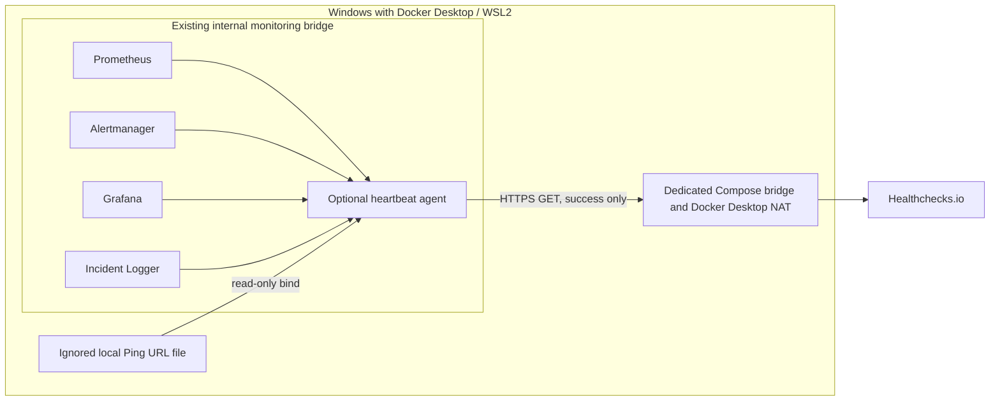

# External heartbeat — design and security

**Status:** implementation prepared and locally testable with mocks; the agent remains disabled. The owner manually created the Healthchecks.io project and check `ITMC - Monitoring Heartbeat`, with a 2-minute period, 2-minute grace time, and email notifications. The check's Ping URL has not been stored locally or mounted into Docker, no real ping has been sent, and neither missed-ping nor recovery behavior has been validated.

## Purpose and scope

The optional agent sends a success ping to Healthchecks.io every 60 seconds only after all four required HTTP health endpoints respond successfully:

| Component | Local check | What it establishes |
|---|---|---|
| Prometheus | `/-/ready` | The server is ready to serve requests |
| Alertmanager | `/-/ready` | The server is ready to serve requests |
| Grafana | `/api/health` | The Grafana HTTP health endpoint responds successfully |
| Incident Logger | `/health` | The local incident receiver responds successfully |

The heartbeat reports the availability of this small monitoring control path. It does **not** assert that every scrape target, alert rule, dashboard query, home-network probe, or monitored system is healthy. In particular, Blackbox Exporter and its probe targets are deliberately excluded: an outage of the router or an external probe target must not be mistaken for loss of the monitoring agent. Node Exporter and the Windows container exporter are also outside this check. Prometheus readiness does not prove that its targets are `UP` or that a particular rule is loaded.

This distinction makes the heartbeat a dead-man's switch for the monitoring stack, not a replacement for Prometheus alerting. If the agent, Windows, Docker Desktop, or the whole site loses power/connectivity, Healthchecks.io can observe a missing ping after its configured schedule and grace period. It cannot deliver notifications while its configured notification channel is unavailable.

## Architecture

The base `compose.yaml` is unchanged and does not contain the agent. `compose.heartbeat.yaml` adds only `heartbeat-agent` and a separate non-internal bridge for outbound HTTPS. The agent joins the existing internal monitoring network for its four HTTP checks. It publishes no host port, uses no host networking or Docker socket, and is not privileged; its local health endpoint binds to container loopback (`127.0.0.1`) and is not reachable through attached network interfaces. It has no Telegram secret mount or service dependencies. Its root filesystem is read-only; it runs as UID/GID 65534, drops all capabilities, sets `no-new-privileges`, and has CPU, memory, and PID limits.

The Compose bridge is not an egress allowlist. The code accepts only an HTTPS URL on `hc-ping.com`, rejects redirects, and sends no service details; however, Compose and this bridge do not prevent a compromised process from making other outbound connections. The agent currently attaches to the internal monitoring network and a separate ordinary bridge, but that egress network has not been created because the service is disabled. Docker Desktop routes Linux container traffic through its VM networking/NAT and, on Windows, through `com.docker.backend.exe`, which originates outbound host TCP connections. A bridge does not itself restrict destination, DNS, protocol, or port.

### Egress assessment and decision

The read-only host audit found the `desktop-linux` Docker context, the existing `itmc-monitoring` bridge marked internal, and no `itmc-heartbeat-egress` network. Windows Firewall profiles are enabled with `DefaultOutboundAction=NotConfigured`; the Windows system default is to allow outbound traffic, and no application-filter rule for `com.docker.backend.exe` was found. The active WSL Hyper-V firewall policy is enabled with inbound Block, outbound Allow, loopback enabled, and host policy merge enabled; all four enabled WSL Hyper-V rules are inbound and none restrict outbound traffic. The local `.wslconfig` contains no explicit networking/firewall/DNS mode overrides beyond its `[wsl2]` section. Docker Engine reports HTTP and HTTPS proxy settings as configured, but their values were not read; daemon proxy configuration does not prove runtime container traffic is forced through an enforcing proxy. These observations do not establish the behavior of an inactive agent network: its DNS resolution and route have not been exercised, and Docker Desktop/VPN/EDR policy can vary by host configuration. No firewall or Docker Desktop settings were changed.

Two future policies are possible:

| Option | Security and compatibility | Complexity, cost, and maintenance | Decision |
|---|---|---|---|
| **A — unrestricted destination egress, explicitly accepted for this personal lab** | Simplest and compatible with the current override. The application intends to call only `hc-ping.com`, but a compromised agent could use any outbound destination reachable through Docker Desktop. Neither the bridge nor the current host firewall defaults enforce an allowlist. | No added service or subscription; low maintenance. | Accept only if the owner explicitly accepts this residual risk. That acceptance has not been recorded, so the agent stays disabled. |
| **B — enforced egress policy** | A destination-aware proxy/firewall must allow only the approved Healthchecks endpoint and deny direct bypass. A Compose bridge alone cannot enforce this. A dedicated proxy plus network enforcement could scope policy to the agent; Docker Desktop's documented air-gapped container enforcement with PAC can also apply destination rules, but it is a Docker Business feature requiring enforced sign-in and managed settings, and its transparent proxy policy can affect other containers unless carefully scoped. | Highest setup and ongoing policy/testing burden. A dedicated proxy requires a maintained service and an enforcement point; Docker Business adds subscription/admin policy dependencies. | Preferred where destination restriction is a requirement. Not configured or verified here; do not activate until a policy is shown to block an unapproved destination while allowing the provider, without disrupting existing services. |

Windows Firewall rules attached to `com.docker.backend.exe` would apply to Docker Desktop's shared networking process, not uniquely to this agent; broad changes could affect Prometheus, Grafana, Telegram, DNS, image pulls, or other containers. Do not add or alter host firewall rules as part of this change. Microsoft's [Hyper-V Firewall documentation](https://learn.microsoft.com/windows/security/operating-system-security/network-security/windows-firewall/hyper-v-firewall) explains that WSL firewall policy is per VM creator; the active WSL policy here allows outbound by default. Windows documents that its standard outbound behavior is allow when no blocking rule applies ([Windows Firewall rule behavior](https://learn.microsoft.com/en-us/windows/security/operating-system-security/network-security/windows-firewall/configure)). Docker's [networking overview](https://docs.docker.com/desktop/features/networking/) documents the Windows backend/NAT path. Docker Desktop distinguishes its host proxy from the Containers proxy; the latter governs running container traffic only when air-gapped container enforcement is enabled. The [air-gapped container feature](https://docs.docker.com/desktop/enterprise/hardened-desktop/air-gapped-containers/) is listed for Docker Business, requires enforced sign-in and managed settings, and can affect all covered containers; verify current plan eligibility and policy behavior before considering it. A generic system proxy is not proof of enforcement: ensure the agent cannot bypass it and verify allowed and denied destinations with an isolated test before use.

## Secret handling

The Ping URL is a bearer secret. The only supported source is `.secrets/healthchecks-ping-url`, which is already covered by the repository's `.secrets/` ignore rule. The opt-in override mounts it read-only at `/run/secrets/healthchecks_ping_url`; a missing file makes only the explicitly requested override invalid and never blocks the default stack. No secret is stored in Compose environment values, CI variables, the repository, the website, or logs. The agent rejects any scheme other than HTTPS, any host other than `hc-ping.com`, unexpected ports, user information, query/fragment components, and non-UUID paths.

The request includes the Ping URL in its HTTPS request path because that is the provider protocol. Application logs never print that URL, request URL, response body, or raw network exception. The provider can see the public NAT egress IP and normal connection metadata; no local address, SSID, MAC, service state, or metric is included in the request body. Protect the local file with reviewed Windows ACLs that retain required SYSTEM, Administrators, owner, and Docker Desktop access; do not remove inherited entries indiscriminately. Rotate/delete the provider check if the URL is exposed. The local ignored Ping URL file is currently absent.

## Schedule and failure behavior

- The agent checks all four endpoints on each cycle; each local request is bounded to 3 seconds by default.
- It sends a GET success ping only if every local check passes. The external request timeout defaults to 5 seconds.
- An unsuccessful local check or provider request marks the agent's local `/health` endpoint unhealthy and sends no success ping. The next cycle retries; there is no unbounded retry loop.
- The provider response is accepted only when it is HTTP 200 with the exact body `OK`; redirects and other HTTP 200 responses are rejected.
- The loop starts a cycle immediately, then targets a 60-second interval between cycle starts. Configuration is bounded to 15–3600 seconds.
- Configure the external check's expected period and grace period in the provider. A starting suggestion is a 2-minute period plus 2-minute grace, subject to review of actual cycle time and notification latency. Provider scheduling and notification delivery are external and have not been validated for this project.
- On loss of Internet access, the agent cannot reach the provider. It will retry on subsequent cycles; it cannot queue pings while offline. After Internet returns, a later successful cycle sends a ping and clears the missed-heartbeat state at the provider. Alert delivery may still be delayed or unavailable during the outage.
- Alertmanager and Incident Logger are checked for HTTP health, but the agent does not send alerts, modify Prometheus state, or read incident records.

The provider's [Ping API](https://healthchecks.io/docs/http_api/) documents the success response and warns that HTTP status alone is not sufficient to distinguish all responses. Check period and grace behavior are described in [check configuration](https://healthchecks.io/docs/configuring_checks/). The owner reports that the check is configured for a 2-minute period, 2-minute grace, and email notification. The provider UI and delivery path were not accessed or independently validated during this audit; no recipient address or check identifier is stored in the repository.

## Validation status

Unit tests use a synthetic reserved UUID URL and a mocked HTTP client. Compose validation renders disposable copies with fake, ignored files and never starts a container. CI does not call `hc-ping.com`. The provider project/check exists by owner-reported manual setup, but the local Ping URL is absent, no real ping has been sent, and no notification, missed-heartbeat, or recovery test has run. External validation remains pending network-egress review, local secret setup, and explicit activation approval. See the [activation and rollback runbook](runbooks/external-heartbeat.md).
