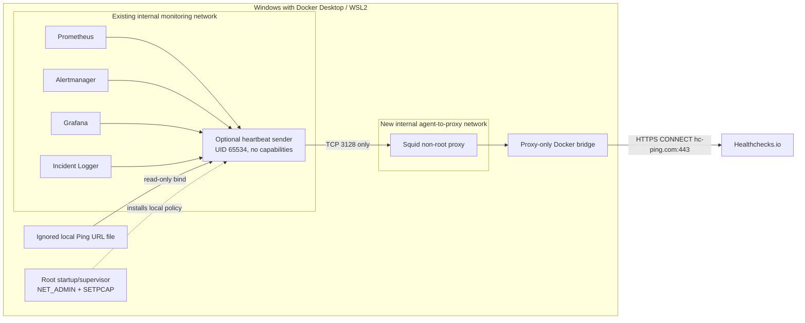

# External heartbeat — design and security

**Status:** option B is implemented in the opt-in Compose override. Isolated runtime checks passed for the agent namespace policy, service-IP refresh, and Squid deny rules. Docker Desktop/WSL2 host-side restriction of the proxy uplink remains unverified, so this feature is not approved for activation. The owner reports that a Healthchecks.io project/check was created manually with a 2-minute period, 2-minute grace, and email notification. The Ping URL has not been stored locally or mounted into Docker; no real ping has been sent, and missed-ping/recovery behavior is untested.

## Purpose and scope

The optional agent sends a success ping every 60 seconds only after all four required HTTP endpoints respond successfully:

| Component | Local check | What it establishes |
|---|---|---|
| Prometheus | `/-/ready` | The server is ready to serve requests |
| Alertmanager | `/-/ready` | The server is ready to serve requests |
| Grafana | `/api/health` | The Grafana HTTP health endpoint responds successfully |
| Incident Logger | `/health` | The local incident receiver responds successfully |

This checks the monitoring control path. It does not assert that every scrape target, alert rule, dashboard query, home-network probe, or monitored system is healthy. Blackbox Exporter and its probes, Node Exporter, and the Windows Container Exporter are outside this heartbeat. Prometheus readiness does not prove that targets are `UP` or that a specific rule is loaded.

If Windows, Docker Desktop, the agent, or the site's Internet connection is unavailable, the provider can observe missing pings after its configured schedule and grace period. Notification delivery still depends on the provider and its independent notification channel.

## Architecture

`compose.yaml` remains unchanged and does not include the heartbeat services. `compose.heartbeat.yaml` adds only the opt-in agent, Squid, and their dedicated networks. The agent attaches to the existing internal monitoring network and an internal private network. The proxy alone also attaches to a separate ordinary bridge. Neither service publishes a host port, uses host networking, mounts Docker Socket, or runs privileged. Docker's `internal: true` network property restricts external connectivity; it is not a destination allowlist and is not treated as the only security control.

The container entrypoint starts as root with only `NET_ADMIN`, `NET_BIND_SERVICE`, `SETPCAP`, `SETUID`, `SETGID`, and `KILL` added after `cap_drop: ALL`. The identity capabilities let it drop dnsmasq and the heartbeat child to separate non-root users. `KILL` lets the supervisor signal those processes for DNS reload and orderly shutdown. Before forking/execing the heartbeat sender it installs IPv4 and IPv6 output/input policy, prepares a local fixed-record DNS resolver, waits for the four internal endpoints and proxy, then installs the final rules. Each firewall chain ends in DROP. Updates build inactive chains completely and switch the active hook with one replacement command so a rule-installation failure does not flush the live policy. A failed initial setup exits before the sender is created.

The parent supervisor remains root with those capabilities so it can refresh the firewall and resolver when Compose recreates services. It does not load the Ping URL or send requests to the provider. The child that runs `heartbeat_agent.py` changes to UID/GID 65534, drops its capability bounding/effective/permitted/ambient sets, and verifies `NoNewPrivs`. Only that child reads the secret file and sends heartbeat requests. This split retains a privileged supervisor in the agent container and is a residual trust boundary; it is not equivalent to a wholly unprivileged container.

The agent's `/etc/resolv.conf` points to a local dnsmasq instance with no upstream and no host-file fallback. It serves only the four fixed Compose service names after the supervisor resolves those names through Docker's embedded resolver. The resolver helper rejects names outside that fixed allowlist before sending a query. Agent-UID queries to Docker's resolver are blocked. Docker Desktop was observed translating `127.0.0.11:53` to a dynamic high port before the container's OUTPUT filter, so the firewall permits only root-owned UDP/TCP traffic to `127.0.0.11` without a destination-port match. The supervisor code requests only the four fixed service names; this is a code-level restriction and the root supervisor remains a trust boundary. IPv4 output is limited to the current private service IPs on their four fixed HTTP ports and the proxy address on TCP 3128; other IPv4 traffic, direct embedded-DNS queries by the sender, and all non-loopback IPv6 output are dropped. Input accepts loopback and established connections only. The supervisor refreshes Docker DNS every 15 seconds; it first permits the union of the old and new private service addresses, updates the local records, then tightens the firewall. A failed DNS refresh retains the prior narrow policy and does not add Internet access.

Squid listens only on the private network address and is configured with no published port, no Linux capabilities, a read-only root filesystem, and non-root UID 13. It accepts only the fixed agent source address, HTTPS `CONNECT`, port 443, and the exact `hc-ping.com` hostname; private, loopback, link-local, shared, documentation, multicast, and reserved destination ranges are denied, followed by `deny all`. `dstdomain -n` avoids reverse DNS for IP-literal requests. Python uses an explicit mandatory proxy handler that ignores `no_proxy`; internal health checks use a separate direct transport. Proxy errors have no direct fallback.

Squid does not decrypt TLS. It sees the CONNECT authority and port, not the encrypted Ping URL path. The proxy therefore cannot redact or inspect that path; access and cache logs are disabled. The proxy is itself a trust boundary: if Squid or its container is compromised, the proxy's uplink may be used directly. The current design does not install host-level outbound rules and does not claim to constrain all Docker Desktop traffic.

## Egress assessment and remaining host limits

The prior read-only host audit found the `desktop-linux` Docker context, the existing `itmc-monitoring` bridge marked internal, no outbound-deny policy in the inspected Windows Firewall/WSL Hyper-V configuration, and Docker Engine proxy settings whose values were not read. Those settings do not prove that runtime container traffic is forced through an enforcing proxy. No host firewall, Docker Desktop, WSL, or existing project service configuration is changed by this PR.

Docker documents that custom bridge networks use the embedded DNS service and that an `internal` network has no normal external route; an attached host or another network can still change the effective path. Review [Docker network creation](https://docs.docker.com/reference/cli/docker/network/create/) and [Compose network options](https://docs.docker.com/reference/compose-file/networks/). Docker Desktop routes container traffic through its VM/backend path on Windows ([Docker Desktop networking](https://docs.docker.com/desktop/features/networking/)); Windows Firewall or WSL Hyper-V rules for that shared backend could affect unrelated containers. The host audit did not establish the exact behavior of every VPN/EDR, DNS-tunneling, mirrored networking, or future Docker Desktop configuration.

The agent firewall is defense in depth inside its own network namespace. It does not protect against a Docker administrator who can replace the image, alter Compose, attach another interface, or execute as container root. The fixed private subnet must be checked for overlap before activation; a collision should prevent network creation and must be resolved by changing the documented fixed addresses consistently, then rerunning all checks. Do not add host firewall rules as a workaround.

## Squid policy and DNS limits

The exact-host ACL matches `hc-ping.com`; it does not allow a suffix or arbitrary destination. The `CONNECT` and port checks reject ordinary HTTP methods and any port other than 443. IP-literal destinations fail the hostname check. A DNS result in the blocked address ranges is rejected by the destination ACL. Squid's official [ACL reference](https://www.squid-cache.org/Doc/config/acl/) documents `dst`, `dstdomain -n`, and their lookup behavior; its [access-control guide](https://www.squid-cache.org/Doc/config/http_access/) documents the ordered deny/allow rules. Runtime tests in this PR must use reserved test destinations and a private-only test network, never the provider's Ping URL.

The local DNS filter prevents the heartbeat sender from querying arbitrary external names. Docker's embedded resolver is used only by the privileged supervisor for four allowlisted service names and by Squid after the exact hostname policy permits a provider request. The current Docker Desktop/WSL2 path was observed in the isolated runtime test; VPNs and alternate Desktop networking modes may differ. The proxy itself does not have a separate DNS egress firewall; a proxy compromise remains outside the agent's fail-closed boundary.

## Secret handling

The Ping URL is a bearer secret. The only supported source is `.secrets/healthchecks-ping-url`, covered by the repository ignore rule and mounted read-only at `/run/secrets/healthchecks_ping_url`. The local file is currently absent. No secret is stored in Compose environment values, CI, source control, the website, or logs. The agent requires HTTPS, the exact `hc-ping.com` host, the expected port, no user information/query/fragment, and a UUID path.

Application logs never print the Ping URL, request URL, response body, or raw network exception. The provider necessarily sees its request path and the public NAT egress IP. The request body contains no local address, SSID, MAC, component detail, or metric. Protect the file with reviewed Windows ACLs that retain required SYSTEM, Administrators, owner, and Docker Desktop access; do not remove inherited entries indiscriminately. Rotate/delete the provider check if the URL is exposed.

## Schedule and failure behavior

- The agent checks all four endpoints each cycle, with a 3-second default per component and a 5-second provider timeout.
- It sends a GET success ping only if every local check passes. Local failure sends no success ping; the next cycle retries. There is no offline queue.
- Provider success requires HTTP 200 and the exact response body `OK`; redirects and other 200 responses are rejected.
- The loop starts immediately, then targets a 60-second interval between cycle starts. Accepted settings are bounded.
- The owner reports a 2-minute provider period, 2-minute grace, and email notification. These settings and delivery have not been independently validated.
- On total Internet loss, the sender cannot reach Healthchecks.io. It retries on later cycles; a later successful cycle clears the missed state. The provider cannot deliver a notification through an unavailable provider/channel.
- Alertmanager and Incident Logger are checked for HTTP health. The agent does not send alerts, modify Prometheus, or inspect incident records.

Healthchecks.io documents its [Ping API](https://healthchecks.io/docs/http_api/) and [check period/grace](https://healthchecks.io/docs/configuring_checks/). No provider endpoint has been contacted during this PR review.

## Isolated runtime audit — 2026-11-04

The checks below used disposable containers and a private-only Docker test network with synthetic RFC1918 addresses and fake service aliases. The test network had no uplink. No Healthchecks.io Ping URL was mounted or contacted, and no existing project container or network was started, stopped, or reconfigured.

| Check | Observed result |
|---|---|
| Startup/fail-closed | The entrypoint applies the bootstrap policy before resolving dependencies or forking the sender. A disposable run without `NET_ADMIN` exited during firewall setup and did not start the sender. Unit tests also force a rule-install failure and verify setup aborts. |
| Sender identity | Runtime child reported UID/GID 65534, `CapEff`, `CapPrm`, `CapAmb`, and `CapBnd` all zero, and `NoNewPrivs=1`. An `iptables` rule-insertion attempt from that child failed. |
| Internal DNS | Root supervisor resolved the four synthetic service aliases through Docker DNS. The local resolver returned the fixed records, rejected an unapproved name, and had no upstream or host-file fallback. Sender direct queries to Docker DNS were blocked. |
| Service recreation | A fake Prometheus service was replaced at a different test IP. The supervisor resolved the new address, staged the union policy, reloaded local DNS, then removed the old address from the active firewall policy. The local record changed to the replacement address. |
| Network bypass paths | Earlier disposable tests observed drops for direct IPv4 to a public address, the network gateway, direct Docker DNS, and a separate IPv6 peer; the IPv4/IPv6 terminal DROP counters increased. Those checks used an internal test network, not an Internet route. |
| Squid ACL | The pinned image digest runs Squid 6.13 and the configuration parsed successfully. Runtime ACL probes on an isolated private network returned HTTP 403 for an unapproved domain, IP literal, unapproved port, subdomain, ordinary HTTP request, and a different client source. No allowed-provider request was sent. |
| Proxy failure | With a synthetic reserved Ping URL and no provider traffic, a stopped/unreachable proxy produced a network error; the sender had no direct transport fallback. |
| Cleanup | Disposable test containers and networks were removed. The original Docker network names remained present and the six ITMC monitoring services remained healthy. |

The existing home-network privacy validator initially rejected the heartbeat's generic private proxy/test literals. It now exempts only exact literals in the specific heartbeat configuration and test files; a focused check confirmed that an unrelated private LAN address in the same candidate file still fails.

The tests establish the container-namespace controls and Squid's deny behavior in isolation; they do **not** establish that Docker Desktop/WSL2 host routing forces the proxy's uplink to an approved destination. The proxy has an ordinary bridge uplink, and no effective host-level egress allowlist was verified. A compromised Squid process/container or Docker administrator could use that path. The permitted `hc-ping.com:443` route was deliberately not exercised, because that would contact an external provider. Host routing through VPN/EDR, DNS transport behavior under other Docker Desktop modes, and actual provider TLS success remain unverified. Therefore option B is not approved for activation yet.

The Python unit suite uses mocked HTTP/DNS/firewall results and a synthetic reserved UUID; those tests are logic checks, not proof of host-level egress isolation. The repository validator likewise does not substitute for runtime testing. Keep the feature disabled until the host-side proxy-egress boundary is verified and reviewed, the local Ping URL is created through the runbook, and the owner explicitly approves real provider pings. No live ping, missed-heartbeat test, or recovery test is part of this phase.

See the [activation and rollback runbook](runbooks/external-heartbeat.md).
