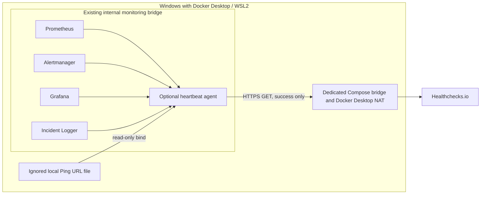

# External heartbeat — design and security

**Status:** implementation prepared and locally testable with mocks. No Healthchecks.io account, check, or real Ping URL has been created or used. External validation is pending explicit setup and approval.

## Purpose and scope

The optional agent sends a success ping to Healthchecks.io every 60 seconds only after all four required HTTP health endpoints respond successfully:

| Component | Local check | What it establishes |
|---|---|---|
| Prometheus | `/-/ready` | The server is ready to serve requests |
| Alertmanager | `/-/ready` | The server is ready to serve requests |
| Grafana | `/api/health` | The Grafana HTTP health endpoint responds successfully |
| Incident Logger | `/health` | The local incident receiver responds successfully |

The heartbeat reports the availability of this small monitoring control path. It does **not** assert that every scrape target, alert rule, dashboard query, home-network probe, or monitored system is healthy. In particular, Blackbox Exporter and its probe targets are deliberately excluded: an outage of the router or an external probe target must not be mistaken for loss of the monitoring agent. Node Exporter and the Windows container exporter are also outside this check. Prometheus readiness does not prove that its targets are `UP` or that a particular rule is loaded.

This distinction makes the heartbeat a dead-man's switch for the monitoring stack, not a replacement for Prometheus alerting. If the agent, Windows, Docker Desktop, or the whole site loses power/connectivity, Healthchecks.io can observe a missing ping after its configured schedule and grace period. It cannot deliver notifications while its configured notification channel is unavailable.

## Architecture

The base `compose.yaml` is unchanged and does not contain the agent. `compose.heartbeat.yaml` adds only `heartbeat-agent` and a separate non-internal bridge for outbound HTTPS. The agent joins the existing internal monitoring network for its four HTTP checks. It has no published port, host networking, Docker socket, privileged mode, Telegram secret mount, or service dependencies. Its root filesystem is read-only; it runs as UID/GID 65534, drops all capabilities, sets `no-new-privileges`, and has CPU, memory, and PID limits.

The Compose bridge is not an egress allowlist. The code accepts only an HTTPS URL on `hc-ping.com`, rejects redirects, and sends no arbitrary destinations or check details; however, Compose and this bridge do not prevent a compromised process from making other outbound connections. Before activation, assess host/Docker Desktop firewall or an explicit egress proxy policy. If a reliable restriction cannot be established for the environment, leave the service disabled.

## Secret handling

The Ping URL is a bearer secret. The only supported source is `.secrets/healthchecks-ping-url`, which is already covered by the repository's `.secrets/` ignore rule. The opt-in override mounts it read-only at `/run/secrets/healthchecks_ping_url`; a missing file makes only the explicitly requested override invalid and never blocks the default stack. No secret is stored in Compose environment values, CI variables, the repository, the website, or logs. The agent rejects any scheme other than HTTPS, any host other than `hc-ping.com`, unexpected ports, user information, query/fragment components, and non-UUID paths.

The request includes the Ping URL in its HTTPS request path because that is the provider protocol. Application logs never print that URL, request URL, response body, or raw network exception. The provider can see the public NAT egress IP and normal connection metadata; no local address, SSID, MAC, service state, or metric is included in the request body. Restrict local file access with Windows ACLs and rotate/delete the provider check if the URL is exposed.

## Schedule and failure behavior

- The agent checks all four endpoints on each cycle; each local request is bounded to 3 seconds by default.
- It sends a GET success ping only if every local check passes. The external request timeout defaults to 5 seconds.
- An unsuccessful local check or provider request marks the agent's local `/health` endpoint unhealthy and sends no success ping. The next cycle retries; there is no unbounded retry loop.
- The provider response is accepted only when it is HTTP 200 with the exact body `OK`; redirects and other HTTP 200 responses are rejected.
- The loop starts a cycle immediately, then targets a 60-second interval between cycle starts. Configuration is bounded to 15–3600 seconds.
- Configure the external check's expected period and grace period in the provider. A starting suggestion is a 2-minute period plus 2-minute grace, subject to review of actual cycle time and notification latency. Provider scheduling and notification delivery are external and have not been validated for this project.
- On loss of Internet access, the agent cannot reach the provider. It will retry on subsequent cycles; it cannot queue pings while offline. After Internet returns, a later successful cycle sends a ping and clears the missed-heartbeat state at the provider. Alert delivery may still be delayed or unavailable during the outage.
- Alertmanager and Incident Logger are checked for HTTP health, but the agent does not send alerts, modify Prometheus state, or read incident records.

The provider's [Ping API](https://healthchecks.io/docs/http_api/) documents the success response and warns that HTTP status alone is not sufficient to distinguish all responses. Check period and grace behavior are described in [check configuration](https://healthchecks.io/docs/configuring_checks/). The provider's current [pricing page](https://healthchecks.io/pricing/) should be checked before account setup; plan limits and pricing can change. No account or plan is selected for ITMC.

## Validation status

Unit tests use a synthetic reserved UUID URL and a mocked HTTP client. Compose validation renders disposable copies with fake, ignored files and never starts a container. CI does not call `hc-ping.com`. No provider account, Ping URL, external request, notification, outage test, or screenshot is part of this implementation. A real external validation remains pending manual provider setup, network egress review, and explicit authorization. See the [activation and rollback runbook](runbooks/external-heartbeat.md).
