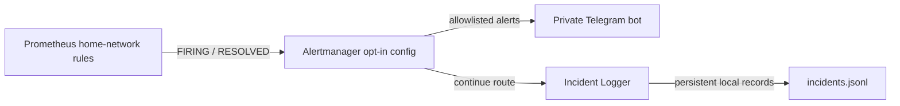

# Phase 8 — Telegram alert lifecycle validation

**Status:** implemented and validated locally. Telegram remains optional for clean installations; the default Alertmanager configuration does not require Telegram secrets.

## Summary

ITMC delivered a controlled synthetic home-network alert to a private Telegram bot and delivered its recovery. Alertmanager also delivered both lifecycle events to the existing Incident Logger, which acknowledged the webhook requests and retained the two records in its local JSONL history. This verifies one local test flow. It does not establish continuous availability, a delivery SLA, or cloud monitoring.

## Architecture and scope

The opt-in route matches `source="home-network"` and the seven explicitly reviewed alert names: `BlackboxExporterDown`, `BlackboxExporterTargetMissing`, `HomeProbeExecutionError`, `HomeRouterTargetMissing`, `HomeRouterUnavailable`, `HomeDNSResolutionUnavailable`, and `HomeInternetHTTPSUnavailable`. Other alerts continue to the default Incident Logger receiver and are not routed to Telegram.

The Telegram child route uses `group_wait: 30s`, `group_interval: 5m`, `repeat_interval: 4h`, and `send_resolved: true`. `continue: true` preserves the paired Incident Logger route and its existing shorter grouping interval. These are Alertmanager grouping and repeat controls, not guarantees that a message arrives within a fixed duration. A short alert can resolve before its first grouped Telegram notification.

The stable `config/alertmanager/alertmanager.yml` remains Logger-only. The alternate configuration and read-only secret mounts are selected explicitly with `compose.telegram.yaml`; a clean clone without local secret files can continue using the default configuration.

## Local validation record

The following results were provided from the authorized local validation of the integration:

| Check | Result |
|---|---|
| Compose configuration with the optional override | `docker compose -f compose.yaml -f compose.telegram.yaml config --quiet` completed successfully. |
| Alertmanager readiness | Container was healthy and `/-/ready` returned HTTP 200. |
| Effective integration | The Alertmanager API showed the Telegram integration and the `telegram-home-network` and `incident-logger` receivers. No rendered configuration or secret values are published here. |
| Synthetic notification | A `HomeRouterUnavailable` alert labeled `source=home-network`, `severity=warning`, and `instance=telegram-delivery-test` was sent through Alertmanager. Telegram received FIRING and then RESOLVED; the synthetic alert was no longer active afterward. |
| Incident Logger | Both webhook requests returned HTTP 200. The local JSONL history contained two records: FIRING and RESOLVED. The private log itself is not included in Git. |
| Screenshot | The sanitized crop shows the controlled warning pair at 08:19 and 08:24 on 4 November 2026, local Panama time. The screenshot displays minute precision only. |

The five-minute difference visible in the screenshot is compatible with the configured `group_interval: 5m`; it does not prove that this setting alone caused the observed delivery time and is not a universal timing guarantee.

The supplied uncropped source also showed a later critical notification pair at 09:06 and 09:09 local time. These timestamps and notification states are observations only; no corresponding Prometheus, Blackbox Exporter, or Incident Logger record was supplied for correlation. Treat the pair as unverified, and do not classify it as a router, ISP, or monitoring outage. It is excluded from the public evidence crop.

## Evidence and privacy

[`screenshots/08-telegram-alerting.png`](../screenshots/08-telegram-alerting.png) is an exact crop from the authentic image supplied for this report. It retains the original pixels and message values for the two controlled warning messages while excluding unrelated chat surroundings and the later unverified notification pair. The repository and website copies have been checked for pixel equality and matching SHA-256; the PNG has no embedded metadata fields.

The published crop contains no bot token, chat ID, account username, private IP address, MAC address, SSID, or personal filesystem path. Do not add local incident exports, Telegram chat exports, secret files, or unreviewed screenshots to Git.

## Secret handling and clean installations

- Keep the bot token and chat ID in separate local files under `.secrets/`; `.gitignore` excludes that directory. Never put either value in Compose YAML, `.env`, a command argument, log, issue, or screenshot.
- Compose mounts each file read-only. Read-only mounts reduce in-container modification, but Alertmanager and Docker Desktop can read the secrets. Protect the Windows account and local directory with restrictive ACLs.
- Verify ignore rules by path only: `git check-ignore -v .secrets/telegram-bot-token .secrets/telegram-chat-id`. Do not print file contents or a rendered Compose configuration.
- A fresh checkout has no credentials and uses the default Logger-only configuration. It does not send Telegram messages until an operator supplies the two local files and deliberately selects the override.

For bot creation with BotFather, private-chat authorization, and safe local file entry in PowerShell, follow the [Telegram operations runbook](home-network-notifications.md). Do not use a third-party bot to retrieve chat identifiers.

## Controlled activation and future test

1. Confirm the destination is an authorized private chat and that the existing local secret files are present without displaying their contents. Confirm Git ignores both paths.
2. Run `docker compose -f compose.yaml -f compose.telegram.yaml config --quiet`. This validates configuration without starting or replacing services.
3. During an approved maintenance window, explicitly select the opt-in configuration for Alertmanager. This replaces its current container and can briefly interrupt notifications; do not treat it as a live reload.
4. Confirm Alertmanager readiness and check the receiver route without exposing configuration values.
5. If a new delivery test is approved, use a clearly labeled synthetic `HomeRouterUnavailable` warning with `instance=telegram-delivery-test`, allow the grouping delay, and verify both FIRING and RESOLVED in Telegram and the Incident Logger. Remove the synthetic alert when finished. Do not disconnect the router or Internet to test delivery.

The lifecycle described above was already tested locally. No additional Telegram message was sent as part of preparing this documentation.

## Delivery, outage, and recovery limits

- Telegram delivery requires outbound HTTPS connectivity to Telegram. No inbound router port, UPnP, or port forwarding is needed or configured.
- During a full ISP or power outage, the local Alertmanager cannot reach Telegram. It may retry while the alert and process remain available, but delivery is not guaranteed. Local Incident Logger delivery can continue only while the local monitoring services and network remain operational.
- `send_resolved: true` requests recovery notifications when Alertmanager can deliver them. It cannot send during a total loss of connectivity.
- Alertmanager notification state uses the existing `alertmanager_data` volume. A restart or a machine shutdown does not guarantee that missed external notifications will be replayed.
- The lab depends on Windows and Docker Desktop/WSL2 being powered on. The public Cloudflare Pages site is static evidence and is not a monitoring endpoint.

## Rollback and compromised token

To return to the default route, use the standard Compose configuration for Alertmanager in an approved maintenance window. This replaces the container; it is not part of this documentation change. Confirm that Logger delivery is healthy after rollback.

If the token may have been exposed, revoke it with BotFather immediately, review repository history and local backups, then replace the local token file and repeat the controlled activation. Removing a secret from the current working tree does not erase Git history. Do not publish the replacement value while reporting the incident.

## Conclusion

This evidence closes the local functional validation of Phase 8: a synthetic warning traversed the opt-in Alertmanager route, both FIRING and RESOLVED reached Telegram, and the Incident Logger retained both events. The setup remains local and manually operated; it is not a permanent notification service or a cloud-hosted monitoring platform.
